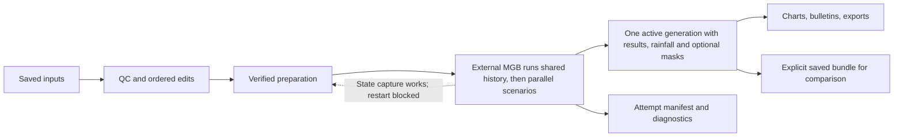

# MGB Ops migration diagnosis

November 21, 2026 · Rust `b6ae27a` · Python `1598164` · VB.NET and bundled Python plugins `10b6152`. Scope covers operations with saved inputs through reporting, sharing, and scheduling. Acquisition is deferred.

**The Linux saved-data core has reached numerical parity for the frozen RS hourly case. The current desktop source fails to build, and several operator workflows remain less direct than in the legacy tools.** The real-engine regression passed for zero rain, raw ECMWF, raw NOAA, and corrected ECMWF. Both executions used the retained preparation after the original catalogs, normalized assets, baseline inputs, and executable were removed from the disposable workspace. The test checked CHUVABIN, raw engine streams, basin and station results, and HAND flood-source depths. Earlier qualification also checked full forcing arrays, selected observations, QC, masks, and local time bounds. Coverage is one Linux case and engine build. The initial state’s hydrological compatibility, Windows operation, and independent flood-footprint accuracy still need evidence. [Regression test](../../tests/rs_saved.rs) · [Scientific qualification](../../references/regression/rs-hourly/rust-qualification.md) · [Inundation evidence](../../references/regression/rs-hourly/inundation.md)

## What carried over and what still needs work

| Area | Working now and where Rust improves | Legacy gap or improvement |
| --- | --- | --- |
| Execution and replay | Python already isolated scenarios and staged publication. Rust adds a reusable, verified preparation, cancellation, per-attempt diagnostics, and one atomic publication for results and rainfall. Failed or cancelled runs preserve the prior active generation. Bundles keep past payloads and can include preparation for regeneration. [Operation contract](../../docs/contracts/operations.md) · [Sharing](../../docs/contracts/saved-data.md#sharing-and-automation) | Operators must save full results before the next successful run. Replay from an attempt manifest depends on recorded inputs still being available. Rust’s qualified path is hourly. Python accepted other integer-hour steps in input preparation, with synthetic coverage for three hours. [Completed runs](../migration/completed_runs.md) · [Python reference](../../references/python_map.md) |
| Review and saved forcing | Transactional canonical intake, immutable raw values, ordered rain and flow edits, explicit zero and missing values, and 72-hour/monthly availability improve on VB.NET history overwrites. Rust implements rainfall QC, spatial checks, and forecast transforms with the same instructions in previews and runs. [Observations](../../docs/contracts/observations.md) · [Forecasts](../../docs/contracts/forecasts.md) | Python chose the newest registered asset covering the forecast window. Rust rolling jobs change the reference but retain asset IDs, so the selected cycle eventually runs out of coverage. Add opt-in selection from saved assets and record the resolved IDs. Python also prefilled QC edits and recorded author/reason. Rust would benefit from suggested edits for explicit approval and stronger edit provenance. [Rolling jobs](../../src/app/automation.rs#L465) · [Python reference](../../references/python_map.md) |
| Engine inputs and calibration | The Linux RS engine ran with private edited geometry and soil files. Rust generates QOBS, reservoir and wind inputs and captures six validated state files. Reservoir and first wind-block changes affected output. [Saved forcing and calibration](../../docs/contracts/saved-data.md#forcing-state-and-calibration) · [Engine probes](../../references/regression/rs-hourly/rust-qualification.md#canonical-forcing-state-calibration-and-bulletin-probes) | VB.NET could promote saved state into the next run and select routing. The supplied inertial build never opened restart state, and Rust rejects restart and Muskingum–Cunge requests. Qualify a compatible build with a chained run. QOBS was read, but its tested change produced identical output. [Engine checks](../../src/app/additional.rs#L92) · [VB.NET workflow](../../references/vbnet_gui_flow.md) |
| Analysis and delivery | Shared series cover level/flow adjustment, peaks, bands, thresholds, and saved-run comparisons. Bulletin exports include PDF, offline HTML, Markdown, CSV, and PNG. Regional values were independently reproduced. HAND masks and coverage-aware return-period GeoJSON add spatial products. [Analysis and reports](../../docs/contracts/saved-data.md#analysis-and-bulletins) · [RS evidence](../../references/regression/rs-hourly/README.md) | The VB.NET archive viewer offered per-overlay bias and interactive annotations. Rust uses one adjustment per analysis request. Its rating curves use monotone tables, while VB.NET used quadratic coefficients. The return-period tool covers a selected day. VB.NET’s MapWindow tool also emitted a whole-horizon maximum and supported a safety multiplier. Verify which options operators need before extending exports. [Hydrograph request](../../src/app/hydrograph.rs#L18) · [VB.NET reference](../../references/vbnet_map.md) |
| Desktop and scheduling | The native interface shares the CLI core. Earlier Linux software-rendered checks exercised synchronized rainfall and inundation maps, active-run refresh, and English and Brazilian Portuguese layouts. The local scheduler has durable slot outcomes, overlap protection, and controlled SMTP tests. [Desktop contract](../../docs/contracts/desktop.md) · [Migration evidence](../migration/summary.md) | **The current build fails** because the inundation controls pass a `String` into two `NaiveDateTime::format` calls requiring `&str`. Operator gaps include guided archive comparisons, QC matrices/maps, geographic before/after correction previews, and bulletin profile editing. The desktop scheduler occupies the sole workflow runner while idle, disabling workflow forms including status refresh. Real operator hardware, Wayland, Windows, and external SMTP delivery remain unverified. [Build error site](../../src/bin/desktop/inundation.rs#L543) · [Scheduler wiring](../../src/bin/desktop/workflows.rs#L226) · [Workflow guard](../../src/bin/desktop/mod.rs#L1689) |

## Performance

| Area | Measured result or code-based estimate | Next improvement |
| --- | --- | --- |
| Saved RS execution | The release regression took **82.63 s** with normalization, preparation, two execution batches, and comparisons. In each batch, engine logs show ~8 s for shared history, then ~12 s for the slowest concurrent scenario. | Time preparation, copies, decoding, and publication separately. Size worker concurrency together with engine OpenMP threads for smaller hosts. [Execution code](../../src/app/operation.rs#L985) |
| Rainfall preparation | The `83×102` grid and 8,649 minis mean **73.2 million** distance evaluations plus full sorts for each grid-to-mini neighbor build. History and the three rainy scenarios rebuild it, for ~293 million distances in one RS preparation. Rust avoids Python’s full distance matrix, but still repeats substantial work. | Share neighbor maps by geometry/grid/settings, group observed samples by hour, and select only the needed neighbors while preserving tie order and the exact regression. [Interpolation](../../src/analysis/spatial.rs#L90) · [Scenario preparation](../../src/app/prepare.rs#L617) |
| Series and maps | A station or mini series query eagerly decodes ~69 MiB of basin variables and masks per distinct RS scenario, about 275 MiB across four. This is logical payload size. Earlier Linux software Vulkan tests cut median short-drag presentation intervals from 168–276 ms to 33–42 ms across map modes. | Read only the requested location, variable, and window. Measure cold and warm chart loads and map responsiveness on operator hardware. [Series loader](../../src/app/series.rs#L137) · [Desktop timings](../migration/summary.md) |
| Inundation | Reusing unchanged tiles reduced generation plus readback from **232 s to 137 s** for raw ECMWF, with identical native and overview masks. A mask is ~1.46 GB per scenario in this case. | Keep overview and tile reads for display. Measure bundle export cost separately when including multiple masks. [Inundation timings](../../references/regression/rs-hourly/inundation.md#reusing-unchanged-tiles) |

Treat these timings as Linux Rust baselines for future profiling.

## Priorities before operational handover

1. Restore the desktop build and run a saved-case smoke test covering run replacement, comparison, and inundation. Exercise the same workflow on operator hardware and Windows.
2. Remove routine manual steps from rolling selection and archive/review/report forms. Keep scheduler status available during service and retain the last validated desktop view until a replacement loads. [Run view loader](../../src/bin/desktop/mod.rs#L635)
3. Qualify restart consumption and alternate routing with a compatible executable. In parallel, profile preparation and chart loads against the frozen case before changing numerical code.

## Checks on this checkout

The default release suite passed 142 tests. The explicit real-engine RS regression and five focused `inundation-write` tests also passed. The latter emitted HDF5 diagnostics for missing attributes. Building the desktop-enabled release tests stopped at the two type errors above. [RS reproduction command](../../references/regression/rs-hourly/rust-qualification.md#execution-and-source-independent-repeat)
