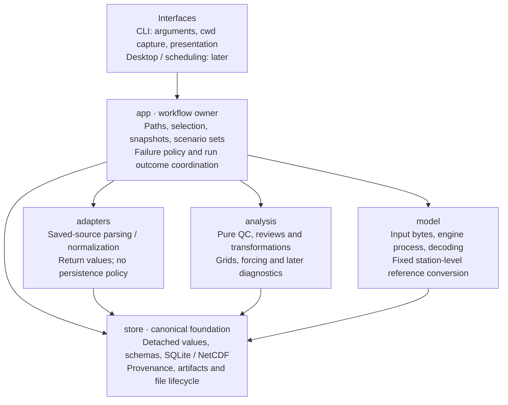
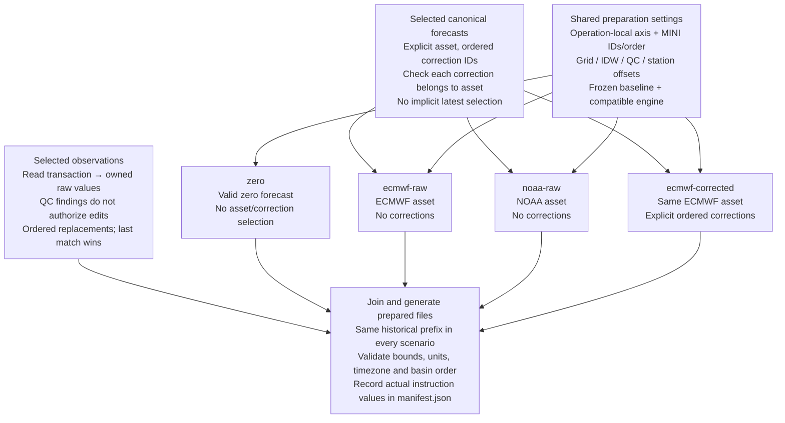
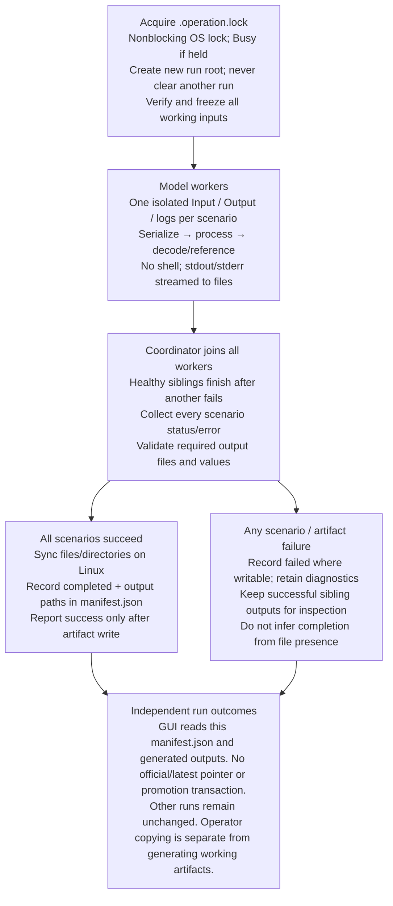
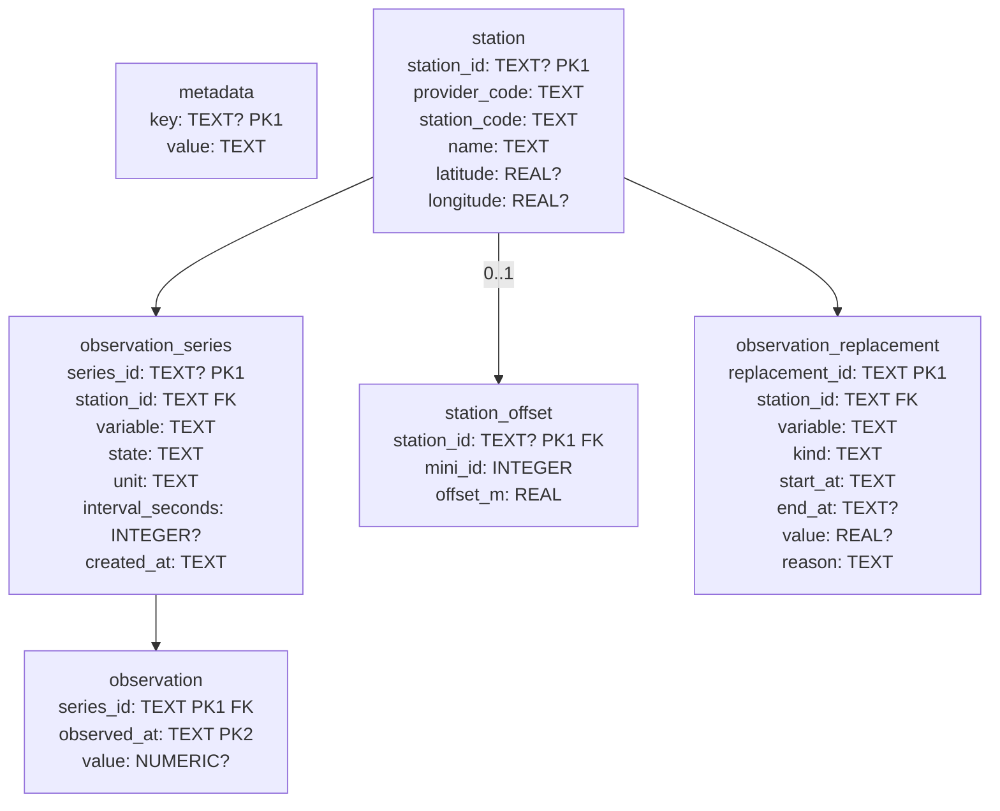
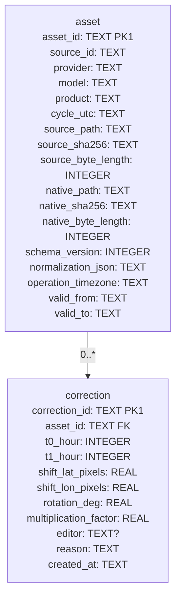
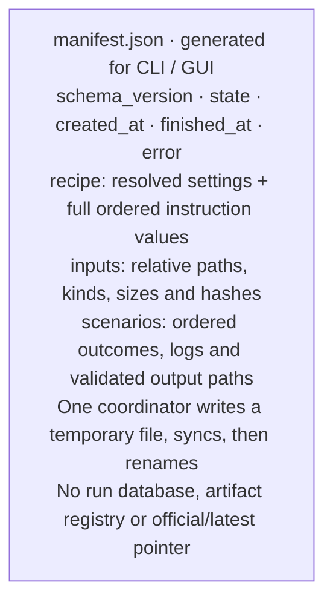
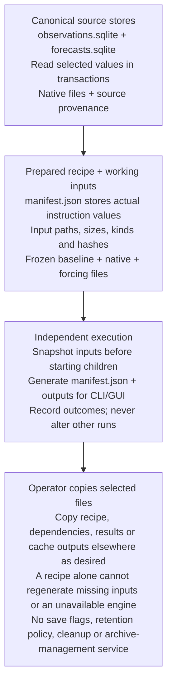
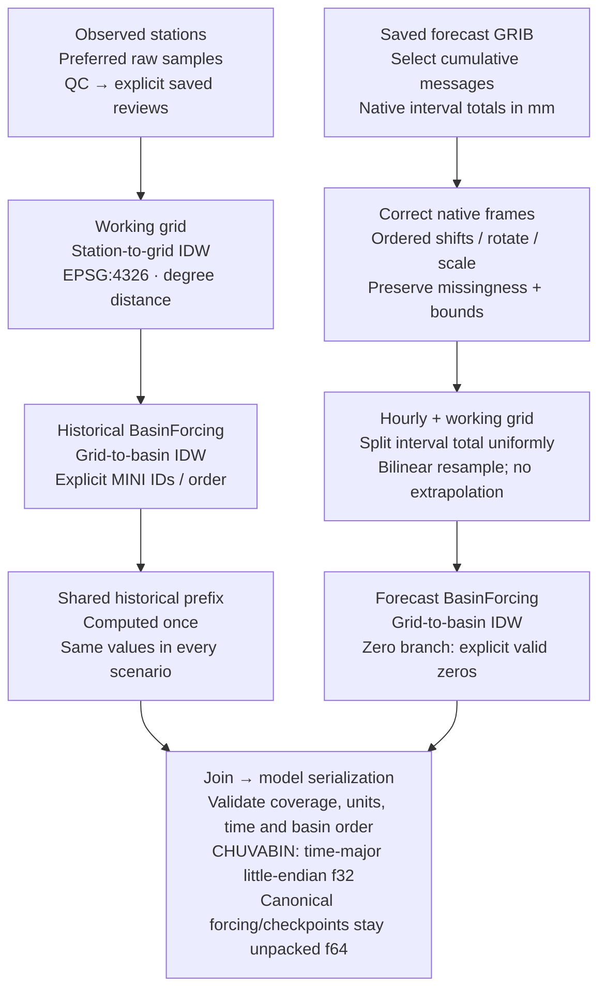
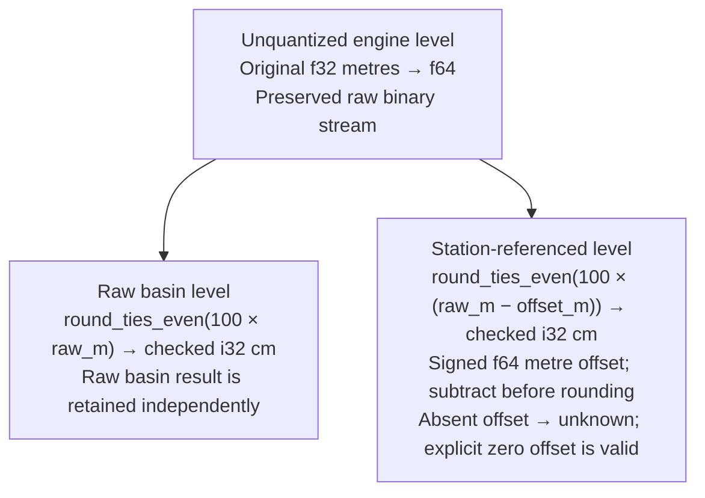

# From saved inputs to independent run results.

Architecture, runtime structure, database relationships and scientific boundaries for the next MGB Ops implementation.

Code/history baseline: `f2dd5ddac09471a272a2be9cb841bc7b85d5b394`  
Revised operational specifications · November 12, 2026 · Mermaid diagrams

## What exists, and what this plan adds

The latest operational specifications describe a Rust-owned preparation and execution pipeline around the existing MGB numerical engine. They are specifications, not implemented operational capabilities.

- 5 core owners in the target design
- 2 workspace SQLite registries
- 4 illustrative RS scenarios
- 1 generated JSON manifest per run

| Commit | Result | Status |
| --- | --- | --- |
| `f2dd5dd` · Nov 11, 2026 | Replaces the operational plan with four specifications; adds canonical storage, timezone and level-reference decisions. | Specified |
| `42f6013` · Nov 11, 2026 | Introduced the RS operational plan; superseded by the specifications above. | Historical context |
| `09f201d` · Nov 11, 2026 | Formatting and CI changes. Linux CI is configured; hosted execution is unverified in the migration record. | Foundation tooling |
| `ed8eab7` / `b4c0d10` · Nov 11, 2026 | Documentation corrections and migration-document organization. | Documentation |
| `00079aa` · Nov 10, 2026 | Rust shared library, thin CLI and bounded read-only workspace inspection. Foundation acceptance remains in progress. | Code exists |

The current CLI offers `config example` and `workspace inspect`, with text/JSON findings. It does not open SQLite, acquire data, prepare forcing, or launch MGB. Current production owners are `app` and `model`; the other owners arrive with their behavior.

Sources: [Current inspection contract](../../docs/contracts/workspace.md) · [Migration status](../migration/summary.md)

## One library, explicit responsibilities

The boxes below are ownership boundaries in one Rust Cargo package, not separately deployed services. CLI and later desktop interfaces invoke the same public library workflows.

### Allowed code dependencies



Arrows mean “may depend on”. App may use all four core owners; adapters, analysis and model may use store, but do not depend on each other. Store has no internal-owner dependency. Existing app/model inspection behavior is extended by the plan.

| Owner | Owns | Boundary that matters |
| --- | --- | --- |
| store | Canonical values, persistence, run recipes and working files | Analysis values do not require a live database or filesystem lookup. |
| adapters | GRIB metadata, provider/product selection and canonical normalization | No catalog writes; app chooses persistence through store. |
| analysis | Preferred-series ranking, QC, explicit reviews, numerical forcing | No provider acquisition, database queries or model imports. |
| model | MINI geometry parsing, engine input/output and station offsets | No app configuration types, catalog queries or run-outcome persistence. |
| app | Selections, strict requests, orchestration, status and run outcomes | Composes core owners; SQL stays in store and binary decoding in model. |
| interfaces | Argument parsing, invocation directory, presentation | Use intended library APIs rather than reaching into private owners. |

The dependency picture describes the target architecture. Only app/model inspection behavior exists at this baseline. Rust privacy and the architecture test enforce source boundaries; behavioral ownership still requires review.

Sources: [Architecture and ownership](../../docs/architecture.md) · [Step 2a · Observed forcing](../../docs/contracts/observations.md) · [Step 2b · Forecast forcing](../../docs/contracts/forecasts.md) · [Step 3 · Execution and run artifacts](../../docs/contracts/operations.md)

## Three workflows, independent run outputs

Normalization imports saved files. Preparation generates a reusable recipe and forcing. Execution freezes working inputs and produces manifest.json plus outputs for CLI/GUI consumption.

### Command and artifact boundaries

```mermaid
flowchart TD
    n0["1 · forecast normalize<br/>--workspace W --request FILE &#91;--json&#93;<br/>Saved GRIB → native values<br/>Store: asset + retained source/native"]
    n1["2 · operation prepare<br/>--workspace W --request FILE<br/>--output NEW_DIR &#91;--json&#93;<br/>Freeze selections; generate recipe/forcing"]
    n2["3 · operation execute<br/>--workspace W --prepared DIR &#91;--json&#93;<br/>Verify recipe inputs; acquire workspace lock<br/>Independent run outputs + manifest.json"]
    n3["Canonical forecast asset<br/>forecasts.sqlite: asset + correction<br/>Explicit asset ID + ordered correction IDs"]
    n4["Prepared working directory<br/>manifest.json + request + frozen inputs<br/>Common history; scenario forcing/checkpoints"]
    n5["Generated run files<br/>manifest.json consumed by CLI / GUI<br/>Frozen inputs + private engine I/O + results"]
    n0 --> n3
    n1 --> n4
    n2 --> n5
    n3 --> n4
    n4 --> n5
```



Planned workflows, not implemented commands. Execution uses frozen working inputs. Generated files are available to the GUI; operators may copy files elsewhere for long-term storage.

### Preparation fan-out and recorded recipe



The saved RS fixture has four scenarios, not a fixed product limit. Historical forcing is computed once. Raw observations remain distinct from selected instructions and effective values.

### Execution coordination and run outcomes



Model workers do not write the run manifest. The coordinator atomically writes the JSON manifest and releases the lock after all launched children finish. Automatic unfinished-run/process-tree recovery remains deferred.

Sources: [Step 2b · Forecast forcing](../../docs/contracts/forecasts.md) · [Step 3 · Execution and run artifacts](../../docs/contracts/operations.md)

## Two registries; one generated run artifact

Keep storage close to its purpose: observations and replacements in six tables, forecast assets and corrections in two tables, and JSON run manifests for application use.

These are planned version-1 schemas, not implemented databases. Every SQLite column is shown below; the run manifest is described separately. ? means nullable in the DDL; PK/FK mark keys. Solid arrows run from parent to child; each parent has zero or many children unless stated otherwise. The run JSON manifest is a generated artifact, not another database.

### Canonical observations · six tables



Raw stations, series and samples stay separate from ordered replacement instructions. No source table or source foreign keys. metadata is standalone. A station has zero or one offset; mini_id is checked against supplied geometry.

#### Observations — literal DDL and validation

```sql
CREATE TABLE metadata(key TEXT PRIMARY KEY,value TEXT NOT NULL);
CREATE TABLE station(station_id TEXT PRIMARY KEY,provider_code TEXT NOT NULL,
 station_code TEXT NOT NULL,name TEXT NOT NULL,latitude REAL,longitude REAL,
 UNIQUE(provider_code,station_code),
 CHECK((latitude IS NULL AND longitude IS NULL) OR
 (latitude IS NOT NULL AND longitude IS NOT NULL AND
 latitude BETWEEN -90 AND 90 AND longitude BETWEEN -180 AND 180)));
CREATE TABLE observation_series(series_id TEXT PRIMARY KEY,
 station_id TEXT NOT NULL REFERENCES station(station_id),
 variable TEXT NOT NULL CHECK(variable IN ('rain','level','flow')),
 state TEXT NOT NULL CHECK(state IN ('approved','curated','raw')),
 unit TEXT NOT NULL,interval_seconds INTEGER,created_at TEXT NOT NULL,
 CHECK((variable='rain' AND unit='mm' AND interval_seconds=3600) OR
 (variable='level' AND unit='cm' AND interval_seconds IS NULL) OR
 (variable='flow' AND unit='m3/s' AND interval_seconds IS NULL)));
CREATE TABLE observation(series_id TEXT NOT NULL REFERENCES observation_series(series_id),
 observed_at TEXT NOT NULL,value NUMERIC,
 PRIMARY KEY(series_id,observed_at),
 CHECK(value IS NULL OR typeof(value) IN ('integer','real')));
CREATE TABLE observation_replacement(
 replacement_id TEXT PRIMARY KEY NOT NULL,
 station_id TEXT NOT NULL REFERENCES station(station_id),
 variable TEXT NOT NULL CHECK(variable='rain'),
 kind TEXT NOT NULL CHECK(kind IN ('point','period')),
 start_at TEXT NOT NULL,end_at TEXT,value REAL,reason TEXT NOT NULL,
 CHECK((kind='point' AND end_at IS NULL) OR
       (kind='period' AND (end_at IS NULL OR start_at<end_at))));
CREATE TABLE station_offset(station_id TEXT PRIMARY KEY REFERENCES station(station_id),
 mini_id INTEGER NOT NULL CHECK(mini_id>0),offset_m REAL NOT NULL);
CREATE INDEX observation_time ON observation(observed_at,series_id);
CREATE INDEX observation_selection ON
 observation_series(station_id,variable,state,created_at);
PRAGMA user_version=1;
```

Point: timestamp = start\_at and end\_at is NULL. Period: [start\_at,end\_at), with NULL end meaning indefinitely. The required replacement\_ids list provides order; last matching instruction wins. NA removes availability; zero remains valid. Empty list means no edits. Validate unknown/duplicate IDs, timestamps and finite values. Raw data is never overwritten; QC does not authorize replacements. Rainfall accumulation bounds remain (start,end]. All IDs must be nonempty; validate integer centimetres and station geometry as specified. Format/timezone metadata and station/series foreign keys remain required.

### Forecast registry · asset + correction



asset combines source provenance and normalized-native metadata. correction has one asset parent. A scenario selects ordered correction IDs; application validation checks they belong to the selected asset. Derived outputs are generated files, not catalog rows.

#### Forecasts — literal DDL and validation

```sql
CREATE TABLE asset (
 asset_id TEXT PRIMARY KEY NOT NULL,source_id TEXT NOT NULL,
 provider TEXT NOT NULL,model TEXT NOT NULL,product TEXT NOT NULL,
 cycle_utc TEXT NOT NULL,source_path TEXT UNIQUE NOT NULL,
 source_sha256 TEXT NOT NULL,source_byte_length INTEGER NOT NULL CHECK(source_byte_length>=0),
 native_path TEXT UNIQUE NOT NULL,native_sha256 TEXT NOT NULL,
 native_byte_length INTEGER NOT NULL CHECK(native_byte_length>=0),
 schema_version INTEGER NOT NULL,normalization_json TEXT NOT NULL,
 operation_timezone TEXT NOT NULL,valid_from TEXT NOT NULL,valid_to TEXT NOT NULL,
 CHECK(valid_from<valid_to)
);
CREATE TABLE correction (
 correction_id TEXT PRIMARY KEY NOT NULL,
 asset_id TEXT NOT NULL REFERENCES asset(asset_id),
 t0_hour INTEGER NOT NULL CHECK(t0_hour>=0),
 t1_hour INTEGER NOT NULL CHECK(t1_hour>=t0_hour),
 shift_lat_pixels REAL NOT NULL,shift_lon_pixels REAL NOT NULL,
 rotation_deg REAL NOT NULL,
 multiplication_factor REAL NOT NULL CHECK(multiplication_factor>0),
 editor TEXT,reason TEXT NOT NULL,created_at TEXT NOT NULL
);
```

Required operation timezone; source cycle remains UTC. Validate hashes, paths, bounds and finite settings. A corrected scenario selects a nonempty ordered correction\_ids list, with no unknown/duplicate or cross-asset IDs. Raw uses no corrections; zero uses no asset. The run recipe records full selected values and order. Persist source/native files before committing the asset row; reject hash/schema mismatches.

### Per-run JSON manifest



One manifest.json per preparation/execution directory. The prepared manifest stays unchanged; execution updates its independent root manifest. Operators may copy files for long-term storage. Numerical arrays remain separate files.

#### Run manifest — format and validation

Schema version 1. State is prepared, running, failed or completed. recipe stores resolved timezone/axes, numerical settings, selected station/series metadata and offsets, full ordered replacement/correction values, and engine/environment identity. inputs lists relative input paths, kinds, sizes and SHA256. scenarios preserves request order, states, timings, exit/signal, errors, logs and validated result paths. finished\_at and error are nullable. request.toml retains accepted request bytes and is an input reference.

Validate JSON structure, schema version, IDs, paths and input hashes before execution. Reject malformed/truncated manifests. Write a temporary sibling, flush/sync, rename atomically and sync the parent on Linux. A failed write must not expose partial JSON or report completion. Hashes cannot recover missing dependencies. No retention flags or archive manager.

Sources: [Step 2a · Observed forcing](../../docs/contracts/observations.md) · [Step 2b · Forecast forcing](../../docs/contracts/forecasts.md) · [Step 3 · Execution and run artifacts](../../docs/contracts/operations.md)

## Working artifacts, with operator-controlled copying

JSON manifests record recipes and outcomes; SQLite stores observations and forecasts; NetCDF holds numerical arrays. Frozen working inputs protect an execution from later edits. Long-term regeneration depends on which referenced files remain available.

### Prepared working directory · schema v1

```text
manifest.json             recipe + input references
request.toml              exact accepted bytes
sources/
  observations.sqlite     raw/replacement/station/offset subset
  forecast.sqlite         selected asset/correction rows
  native/<source-id>.nc
baseline/
  Input/...               calibration + unchanged saved state
  engine                  frozen executable, mode preserved
forcing/
  observed.nc
  <scenario-id>.nc        historical + forecast basin forcing
checkpoints/...           effective rows, QC, working/transformed grids
```

### Workspace execution tree

```text
data/observations.sqlite   canonical observations + replacements
data/forecasts.sqlite      asset + correction registry
data/runs/<run-id>/
  manifest.json           generated recipe/outcomes for GUI
  snapshot/...            frozen prepared working inputs
  scenarios/<id>/
    Input/...             independent writable baseline copy
    Output/...            original separate engine streams
    logs/                 stdout.log, stderr.log, execution.json
  results/<id>/
    basin.nc
    station.nc
.operation.lock           OS lock ownership; do not unlink
```

### Working artifacts and operator storage



Files are generated for consumption during normal operation. Long-term copying is the operator’s choice. Cached outputs can avoid recomputation; future regeneration requires available dependencies and a compatible engine.

Verify input hashes after copying; never hard-link mutable inputs or copy a live SQLite/WAL file blindly. Preparation finalizes by staging rename to a new destination. Execution verifies required outputs and records independent run outcomes; there is no promotion transaction. The root manifest.json points into snapshot/; its copied prepared recipe stays unchanged. Hash the prepared manifest separately rather than listing it as its own input. Update run manifests atomically through a temporary sibling file so readers never see partial JSON.

Sources: [Step 2a · Observed forcing](../../docs/contracts/observations.md) · [Step 2b · Forecast forcing](../../docs/contracts/forecasts.md) · [Step 3 · Execution and run artifacts](../../docs/contracts/operations.md)

## Preserve meaning at every conversion

The report explains the specified data contracts; it does not validate their numerical equivalence. Reference qualification settles the saved case’s engine timing and full-level output strategy before implementation acceptance.

### Forcing pipeline and precision boundary



The two IDW kernels deliberately retain different exact-coincidence rules. Forecast corrections operate before hourly splitting and resampling. A raw forecast skips correction; a zero forecast bypasses provider normalization. Analysis returns canonical values; model owns engine bytes.

| Contract | Specified representation | Why it matters |
| --- | --- | --- |
| Time | Operation-local labels + explicit IANA zone. Rainfall covers `(start,end]`; source cycle stays UTC. | Reject ambiguous/nonexistent local endpoints and unqualified timezone-offset transitions. |
| Missingness | SQLite NULL / absence; numerical arrays have explicit validity masks. Zero is valid. | NULL replacement removes availability; QC findings do not authorize automatic replacements. |
| Grid / basin arrays | Grid `[time,latitude,longitude]`; basin `[time,basin]`; explicit coordinates and mini IDs. | Longitude varies fastest. Preserve geometry order rather than treating row index as mini ID. |
| Forcing NetCDF | Unpacked f64 mm, time bounds, i64 local-origin seconds, u8 masks; invalid rainfall payload NaN. | No 0.001 quantization. Complete prepared forcing must have finite valid coverage. |
| Engine boundary | CHUVABIN little-endian f32, no header/record markers. Preserve separate original flow/level streams. | Decode Atual and Prev streams independently using qualified lengths and result labels. |
| Results | Rain/flow f64; signed i32 centimetre levels; separate u8 masks; explicit time segment. | Retain raw f32 metre streams. Invalid integer payload is zero with valid=0; zero with valid=1 remains a measurement. |

### Fixed station-reference conversion



Model applies supplied fixed offsets without catalog lookups or estimating them from observations. Multiple stations may share one basin and use different offsets. Observation-based AR(1) correction belongs to later analysis and is deferred.

**Rounding order changes the answer.** The specified regression example uses the actual f32 sample nearest 1.0041 m and an offset of 0.609 m: raw level is 100 cm and station-referenced level is 40 cm. Subtracting from already rounded raw centimetres would incorrectly yield 39 cm.

#### Illustrative saved RS settings — not production defaults

Operation zone `America/Sao_Paulo`; reference July 20, 2026 at 00:00 local. The captured convention contains 241 historical rows and 121 forecast rows (362 total), with a provisional final forecast endpoint July 25 at 01:00. Step 1 must qualify the mapping to engine result samples; do not treat these counts as a universal horizon policy.

Working resolution 0.1°, saved native forecast resolution 0.25°, IDW k=5 / power=2, saved working grid 83 × 102. ECMWF fixture correction: +8 latitude pixels, −12 longitude pixels, +45° rotation, ×1.5 during hours 0–126. These are explicit fixture settings. Six curated NULL replacements are retained instructions, rather than QC-generated authorization.

Sources: [Step 1 · Reference qualification](../../references/regression/rs-hourly/README.md) · [Step 2a · Observed forcing](../../docs/contracts/observations.md) · [Step 2b · Forecast forcing](../../docs/contracts/forecasts.md) · [Step 3 · Execution and run artifacts](../../docs/contracts/operations.md)

## What can fail, and what remains unresolved

The architecture preserves frozen working inputs and controlled failure handling. Scientific and format qualification remain explicit delivery gates, rather than assumptions hidden in the diagrams.

| Trigger | Planned behavior | Run outcome |
| --- | --- | --- |
| Workspace is busy | Return Busy; do not reserve or clear another run root. | No run starts. |
| Invalid selection, uncovered forcing or changed source | Fail preparation; preserve sources and failed staging diagnostics. | Existing runs unchanged. |
| Input verification/copy failure | Retain diagnostics; launch no children from incomplete inputs. | No successful execution reported. |
| Spawn, nonzero exit, malformed stream or decode/reference error | Fail that scenario; healthy siblings finish; join all launched children. | Run failed; successful sibling outputs remain inspectable. |
| File sync or run-artifact write failure | Keep generated files/diagnostics; record failure where writable. | Do not report completed. |
| Process terminates before outcome recording | Files or running records may be incomplete; never infer completion from presence. | Automatic unfinished-run/process-tree recovery deferred. |

| Gate | Status at source baseline | Required evidence |
| --- | --- | --- |
| Corrected reference r2 | Not accepted | Preserve r1; qualify timing/row mapping, checkpoints and four scenarios, with exact fresh repetition. |
| Complete observed-level strategy | Unresolved | Resolve engine-overwritten YTUDO prefixes. The runtime strategy is not prescribed as interception or an extra run. |
| Terrio GRIB / NetCDF | Qualification required | Probe saved ECMWF CCSDS / NOAA data, precision, metadata/masks and exact canonical NetCDF round trips. Candidate pinned source revision: `29fd6e78ba290e37e58aac16df61883e8ed4aed3`; features `grib,netcdf-hdf5`, no GDAL. |
| Linux operational acceptance | Not implemented | Synthetic tests plus explicit real saved-case acceptance, failure injection and directory durability checks. |
| Windows | Unverified | Build/runtime and durability evidence remain unqualified; Linux inspection evidence does not imply Windows support. |
| State / hydrology | Existing caveat | Carry saved state unchanged. This increment does not certify state suitability or hydrological validity. |

### Delivery dependencies

1. **Step 1:** corrected reference and shared canonical contracts.
2. **Steps 2a / 2b:** observations and forecasts can progress independently, sharing store values, NetCDF contracts and spatial kernels. Forecast I/O acceptance depends on Terrio qualification.
3. **Step 3:** integrate forcing, retained preparation, engine execution, decoding and per-run recipe/outcome artifacts.

Later product scope Live acquisition, desktop framework, hot-start generation/chaining, calibration editors, AR(1), bulletins, completed-run sharing, scheduling and email are outside these four specifications. The broader architecture commits to those capabilities without prescribing their full implementation here.

Sources: [Step 1 · Reference qualification](../../references/regression/rs-hourly/README.md) · [Step 2b · Forecast forcing](../../docs/contracts/forecasts.md) · [Step 3 · Execution and run artifacts](../../docs/contracts/operations.md) · [Migration status](../migration/summary.md)

## Trace every view to its specification

This is a disposable visualization of the current specifications, including the November 12, 2026 simplification. The linked documents remain authoritative; this report does not replace their contracts or prescribe additional architecture.

- [Architecture and ownership](../../docs/architecture.md)
- [Step 2a · Observed forcing](../../docs/contracts/observations.md)
- [Step 2b · Forecast forcing](../../docs/contracts/forecasts.md)
- [Step 3 · Execution and run artifacts](../../docs/contracts/operations.md)
- [Step 1 · Reference qualification](../../references/regression/rs-hourly/README.md)
- [Migration status](../migration/summary.md)
- [Current inspection contract](../../docs/contracts/workspace.md)

Code baseline: [library facade](../../src/lib.rs) · [current CLI](../../src/main.rs) · [architecture gate](../../tests/architecture.rs).

Code/history baseline `f2dd5ddac09471a272a2be9cb841bc7b85d5b394` · November 11, 2026; specification/report revisions November 12, 2026. Links resolve in the repository checkout. The diagrams require a Markdown viewer with Mermaid support.

Read the diagrams as a visualization of the specifications, not evidence of operational acceptance.

No pipeline execution, numerical qualification, deployment or hydrological validation is performed by this report.
