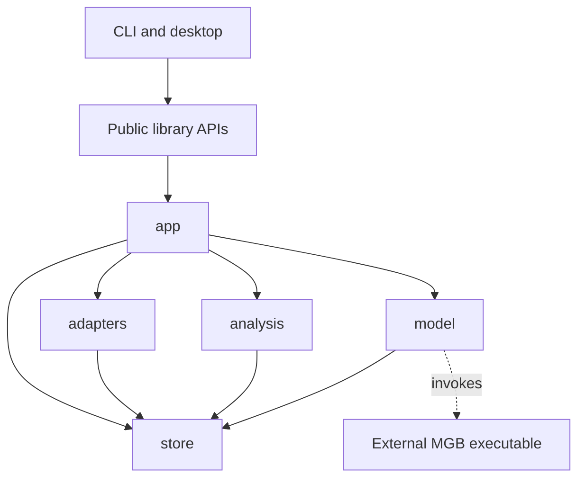

# Architecture

Use one Rust Cargo package with a shared library, thin CLI and optional native
desktop interface. Desktop dependencies are enabled only by the `desktop` feature.
The external MGB executable remains the numerical engine. Add owners only when
behavior exists; app, store, adapters, analysis and model own the implemented
inspection, saved-forcing and execution capabilities.

## Product direction

The intended application targets Linux and Windows. Core operations remain
available through the CLI and shared library workflows.
Operational capabilities belong in Rust, including station-inventory updates and
bulletin generation currently supplied by regional Python scripts. Regional data
and settings remain in independently selected workspaces.

The intended scope includes acquisition, QC/corrections, forcing preparation,
scenario execution and hot starts, geometry/calibration editors, analysis,
bulletins, completed-run sharing, scheduling, and email. ONS meteorological
forecast products are excluded; ONS hydraulic observations and reservoir schedules
are included. Both existing bulletin families inform report content, with PDF,
Markdown, HTML, and relevant CSV exports. Sharing concerns completed runs between
independent workspaces; live multi-operator editing is outside scope. These are
product commitments; the [workspace](contracts/workspace.md),
[observation](contracts/observations.md), [forecast](contracts/forecasts.md) and
[operation](contracts/operations.md) contracts describe implemented behavior.

## Ownership

| Owner | Responsibility | Allowed internal dependencies |
| --- | --- | --- |
| `store` | Canonical data, schemas, metadata, persistence, queries, provenance, file lifecycle | None |
| `adapters` | Provider acquisition, source parsing, normalization; return data without deciding persistence | `store` |
| `analysis` | QC, corrections, transformations, forcing, diagnostics, metrics, report content/rendering | `store` |
| `model` | Engine prerequisites, input serialization, execution, state mechanics, staged decoding, fixed station-reference conversion | `store` |
| `app` | Workflows, private configuration/path resolution, selection, preparation/scenario coordination, failures, run outcomes | All four core owners |
| CLI and desktop | Arguments/project selection, invocation-directory capture, presentation and interactive state | Intended public library APIs |

These boundaries keep scientific processing independent of acquisition, registry
lookups, and execution coordination. Canonical values work without database
connections or filesystem state. Adapters, analysis, and model do not depend on
each other. App supplies selected data to analysis for canonical forcing, then to
model for serialization, execution, and staged decoding. App also coordinates
analysis for downstream diagnostics and rendering.

Keep storage implementations private in store, rendering private in analysis,
and interactive state in interfaces. Configuration/path helpers stay private in
app; core modules receive explicit resolved inputs. Model never imports app's
configuration/report types. App assembles inspection findings from model's explicit
prerequisite checks. The root facade declares modules and re-exports intended APIs;
composition lives in app. Prefer deep modules with narrow APIs and private internals.

Define concrete schemas, units, interval bounds, and missing-value semantics when
first used. Do not equate missing values with zero or silently discard timezones.

## Application sessions and the assistant

App owns the process-local session for an explicitly selected workspace. It
holds the configuration selection, the viewed run, and the current run
parameters. Reads that follow the active generation hold the cache's shared
guard through artifact access. Run parameter proposals apply to the same
session and revision, with updates serialized against job admission.

Saved assistant conversations are local application state, separate from regional
operational records, so browsing an inspect-only workspace does not require an
initialized operation database. Store owns their persistence. Agent working
directories remain isolated per conversation; connection credentials are ephemeral.

The assistant uses ACP for agent interaction and an MCP connection scoped to
the conversation. App owns dispatch and uses the same run parameters as
operators. Operator approval applies proposed parameter changes to the open
form. See the [assistant contract](contracts/assistant.md).

## Operational data decisions

Saved operations use Rust-owned canonical formats. The workspace's
`operation.sqlite` holds observations, station metadata, review instructions,
forecast records, the run index, and the active generation. Initialize the
complete schema without database schema versioning. NetCDF holds large
scientific arrays. Store owns the schemas and the lifecycle of those files.
A run manifest carries the resolved inputs and outcomes.

Geometry and CRS readers are store capabilities using the pinned Terrio vector
integration. Analysis derives upstream membership from validated model topology and local areas, not map-coordinate
area estimates. Reference CSV adapters parse values; app resolves explicit station
identities and store replaces references transactionally. Read-only opens never migrate. See the [spatial](contracts/spatial.md) and
[reference-level](contracts/observations.md#station-reference-levels) contracts.

Observation replacements preserve raw measurements and support a point or a
[start,end) period, with an absent end meaning indefinitely. NA replacements
express exclusions. Automatic precipitation flags mask raw rainfall in the
final observation view before replacements; ordered selected instructions apply with last match winning.
App selects forecast scenarios for each run. Each corrected scenario binds
ordered transformation values to a concrete asset. The run manifest owns
those values. See [scenario selection](contracts/operations.md#scenarios).

Canonical timestamps use the operation's timezone, recorded in artifact metadata.
Forecast normalization converts source UTC timestamps into that convention while
preserving source cycle and interval provenance. This keeps canonical observation,
forcing, and result times aligned with the operation.

### Level reference and analysis corrections

Store persists fixed station-offset records alongside station metadata. Records
are keyed by station and identify the supplying model mini-basin, signed offset
in metres, and provenance. Different stations may share a mini-basin and have
different offsets. Missing offsets remain unknown; explicit zero is valid.

Model applies supplied fixed offsets as station level = engine level minus
offset. Canonical level observations and results use signed integer centimetres;
offsets retain their supplied precision in metres. Subtract from the unquantized
engine level before converting once to centimetres, using nearest rounding with
ties to even and checked integer range. Preserve original engine streams, raw
canonical levels by basin, and referenced levels by station. App supplies and
snapshots the offset records; model does not query catalogs or estimate offsets
from recent observations.

Fixed reference conversion belongs to the model pipeline. Analysis can apply
observation-based AR(1) to retained flow or level series for comparison and
reporting. It uses the raw and referenced model results without rewriting them.
See [analysis and bulletins](contracts/saved-data.md#analysis-and-bulletins).

## Enforcement

Rust privacy protects owner internals. Cargo's `unsafe_code = "forbid"` lint
applies to owned targets; dependencies may use unsafe internally.
The [architecture test](../tests/architecture.rs) enforces these source boundaries:

- Every Rust source under `src/` belongs to a declared owner, the root facade, or
  an interface (`main.rs` or `bin/`). Conditional code is checked too.
- Cross-owner references use explicit `crate::<owner>` paths and obey the table
  above. Relative paths stay within their owner; cross-owner glob imports are
  forbidden. Interfaces use intended public `mgb_ops` APIs.
- The root facade contains only owner module declarations and explicit public
  re-exports. It contains no workflow code or wildcard re-exports.
- Inside an owner, public re-exports expose items from its own private submodules
  through `self::<private_module>::<item>`. Imported foreign items cannot be
  republished to disguise a forbidden dependency.
- Paths in supported macros and attributes are checked. Unsupported constructs
  and generated source are rejected rather than silently left unchecked.

Run `cargo test --locked --test architecture` independently or as part of
`cargo test --locked`.
See the [development checks](../README.md#development) for the full local
validation commands.
The gate checks bounded source syntax, not behavioral ownership or execution
lifecycle correctness; review and behavior tests must cover those responsibilities.
Checker allowlists, parser mechanics, supported syntax, and known limitations stay
beside the test. Extend its checks and fixtures when adding needed syntax, without
weakening the ownership rules to accommodate a bypass.

## Execution lifecycle

Saved preparation and execution follow these rules:

- At startup, app freezes actual selected observations, forecasts, corrections,
  settings, calibration, geometry, initial state, and station offsets, and records
  executable identity.
  Store retains values or immutable versions, not merely selectors, mutable paths,
  or hashes without retained data.
- Later acquisition/editing cannot alter an execution. Refreshing inputs creates a
  new snapshot. An explicitly saved preparation retains the data for exact
  execution later.
- Model stages canonical outputs. App owns execution status, overlap/failure policy,
  and scenario-set coordination; store owns persistence and file lifecycle.
- Each workspace publishes a single active generation containing results and
  rainfall from the same validated execution. Inundation products extend that
  generation. Store owns atomic publication and file retirement. App decides
  when to commit based on all requested scenarios and required outputs.
- Superseded and failed attempts retain their manifests. Operators explicitly
  export full results or save reusable preparations for long-term retention.
  See the [operation contract](contracts/operations.md#active-run-and-rainfall-cache).

The [operation contract](contracts/operations.md) defines prepared snapshots,
isolated execution and the active cache. App owns cancellation
and progress. Model stops and reaps its owned child processes using an explicit
cancellation signal. CLI uses `ctrlc` for portable SIGINT delivery to that shared
control, rather than asynchronous signal handling inside the engine layer. The saved state is carried
unchanged; hot-start generation and chaining follow later.
