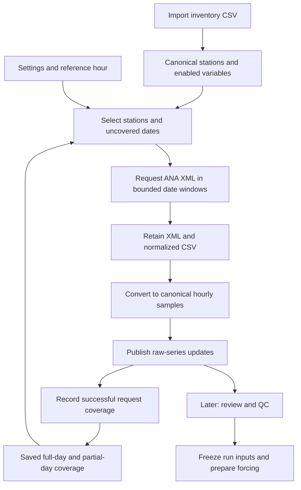

# Acquisition and input updates

Acquire ANA observations, ECMWF IFS precipitation, and NOAA GFS precipitation in a
selected workspace. The catalogs feed the existing observation and forecast
selection workflows.

```sh
mgb-ops observation acquire --workspace /regional/workspace --json
mgb-ops observation import-ana-csv --workspace /regional/workspace --input saved/observed.csv --json
mgb-ops forecast acquire --workspace /regional/workspace --json
mgb-ops operation run-all --workspace /regional/workspace --json
```

In desktop Processing, **Acquire inputs** exposes the first three actions and
**New run → Run All** acquires the configured inputs and executes the run. Jobs shows provider
progress, committed results, and failures. Leave the reference blank to use
`run.reference_time`. When that setting is `now`, acquisition uses the current
local hour. Supply a local, hour-aligned `YYYY-MM-DDTHH:00:00` value with
`--reference-time` to override it. Cancellation stops after
the current bounded request or write and preserves committed data. NOAA spacing
is interruptible.

Workspace commands read `config.toml`. Set the enabled providers under
`[acquisition]` and the forecast bounds under `[spatial]`. Defaults are 90
observation days, 30 days per request window, a 15-second timeout, four forecast
cycles, and a 2.0 buffer fraction. The adapters aggregate rain by sum and level
and flow by mean.

```sh
mgb-ops observation import-inventory --workspace /regional/workspace --input /regional/workspace/source/history_station_inventory.csv
```

Import the ANA station inventory before acquisition. Use `observation
export-inventory --workspace /regional/workspace --output inventory.csv` to
export the saved inventory for editing. Per-station variables are
stored with the station inventory in `assets/registry.sqlite`. Acquisition
updates the canonical assets. Raw captures can be removed after normalization. CLI JSON reports station or provider outcomes.
Standalone acquisition keeps successful sibling results on failure or cancellation.

## CLI download progress

For `observation acquire`, `forecast acquire`, and the download phase of
`operation run-all`, the CLI shows live progress on stdout in text mode and
stderr with `--json`. A terminal shows the active ANA station, request window,
row count, and a requesting or loading spinner. Redirected output and
`TERM=dumb` use one completion line per station. Forecast output lists each
attempted cycle and the provider's outcome. A terminal also shows the current
forecast lead. Completion lines report whether the station had data and whether
each forecast asset was registered or reused.

The forecast buffer expands each edge by its axis span times the configured
fraction. The expanded bounds must fit within geographic limits. Forecast
providers are unique and processed in configured order. ANA reads station
selection and enabled variables from the canonical inventory.

## ANA observations

ANA is the integrated workspace station-acquisition path. BNDMET/INMET and ONS
produce files through [standalone acquisition](#standalone-source-acquisition)
for later ingestion.



### Inventory and request selection

| Inventory column | Role |
| --- | --- |
| `provider_code`, `station_code` | Provider identity; acquisition selects ANA rows from a mixed-provider inventory |
| `station_name` | Display name, updated for known stations |
| `latitude`, `longitude` | Station coordinates, updated for known stations |
| `observed_variables` | Enabled `rain`, `level`, and/or `flow`; `none` disables requests for that station |

Station codes match after trimming whitespace and leading zeros. Import retains
existing station identities. Acquisition reads the saved canonical inventory;
editing the original CSV takes effect after another inventory import.

For each selected station, acquisition considers São Paulo calendar dates in
the configured lookback window. Coverage is keyed by station and the selected
variable set. Stations are processed sequentially; consecutive uncovered dates
are grouped into requests bounded by the configured window size.

| Coverage or request condition | Action |
| --- | --- |
| Historical date has no successful coverage record | Fetch the date |
| Historical date was successfully requested, including an empty response | Reuse coverage and skip the date |
| Current provider day is covered through the requested reference hour | Reuse partial-day coverage |
| A later current-day hour is requested | Fetch that day again |
| `--force` is supplied | Request all dates in the configured window again |

Missing measurements alone do not invalidate successful historical coverage.
Use `--force` to retrieve revisions or retry a previously empty historical day.
Full-day coverage is stored with canonical observations; current-day progress
is retained in `assets/ana-partial-coverage.json`. Future and incomplete-hour
readings are excluded using the current completed-hour cutoff.

### Retained responses and normalization

Requests use the [ANA ServiceANA operation](https://telemetriaws1.ana.gov.br/serviceana.asmx?op=DadosHidrometeorologicos).
XML is retained before parsing. A completed station also retains the normalized CSV:

```text
downloads/ana/<attempt>/<station>/
├── YYYYMMDD__YYYYMMDD.xml       Original response for each requested date window
└── observed.csv                Normalized source readings before hourly import
```

The CSV columns are `provider_code`, `station_code`, `observed_at`,
`variable_code`, and `value`. Source timestamps are reduced to minutes and
normalized to São Paulo local time for CSV. Import converts them to the
observation store's declared timezone and groups readings into hour-ending
buckets: readings at 10:15 and 10:45 contribute to the sample labelled 11:00;
a reading exactly at 11:00 also belongs to that bucket.

| Variable | Hourly aggregation | Canonical value |
| --- | --- | --- |
| Rain | Sum | Finite f64 millimetres |
| Level | Mean, then nearest integer with ties to even | Signed i32 centimetres |
| Flow | Mean | Finite f64 cubic metres per second |

Empty source values yield no sample. Numeric zero is valid. The
[observation contract](observations.md#data-model) defines canonical schemas
and missing-value semantics.

### Publication, failures and downstream use

Incoming values revise the station's unambiguous raw series in one transaction;
a raw series is created when needed. The station samples and their complete and
partial acquisition coverage publish in the same revision. Higher-ranked series, manual replacements, and already
frozen run inputs retain their values. The regular
[canonical JSON intake](saved-data.md#canonical-data-and-review) still rejects
conflicting raw samples.

| Outcome | Retained data |
| --- | --- |
| Station succeeds | Published raw observations, normalized CSV, XML and coverage |
| Station fails | Already captured XML and previously committed data; the failure is reported and other stations can continue |
| Acquisition is cancelled | Committed station data and responses already captured |

Acquisition stores raw canonical measurements. Automatic precipitation flags,
ordered manual replacements and interpolation belong to later
[review and preparation](observations.md#selection-reviews-and-preparation).
Run All completes acquisition before [registering its selected inputs](inputs.md).

| Owner | Responsibility in this flow |
| --- | --- |
| `app` | Select stations and dates, coordinate requests, imports and coverage updates |
| `adapters` | Provider requests, XML/CSV parsing, timezone conversion and hourly aggregation |
| `store` | Validate and publish raw series, inventory and coverage |
| `analysis` | Downstream QC, effective observations and forcing preparation |

## Forecast acquisition

- ECMWF IFS Open Data 0.25° `fc` surface `tp` uses 00 and 12 UTC cycles, with
  0–144 h every three hours and 150–360 h every six hours. Acquire individual
  fields using the published index and ranges, then crop locally.
  [ECMWF product schedules](https://confluence.ecmwf.int/spaces/DAC/pages/272310539/ECMWF%2Bopen%2Bdata%2Breal-time%2Bforecasts%2Bfrom%2BIFS%2Band%2BAIFS),
  [ECMWF byte-range protocol](https://confluence.ecmwf.int/spaces/DAC/pages/738041083/ECMWF%2Bopen%2Bdata%2Bgetting%2Bthe%2Bdata)
- NOAA NOMADS GFS 0.25° surface APCP uses 00, 06, 12, and 18 UTC cycles, with
  3–240 h every three hours and 252–384 h every twelve hours. Request the
  buffered region with at least ten seconds between requests. A fresh cycle
  takes at least 15 minutes before transfer and processing time.
  [NOAA GRIB Filter guidance](https://nomads.ncep.noaa.gov/info.php?page=gribfilter)

Start with the latest scheduled cycle at or before the reference. An unavailable
cycle falls back within the configured lookback. Invalid GRIB2, conflicting
assets, and local persistence errors are reported for that provider. Reuse
verifies the normalized grid, complete native schedule, requested crop, and
timezone. It works after removal of the original download. Use `--force` to fetch
again and publish a verified replacement for the same logical asset in the [forecast catalog](forecasts.md#native-values-and-persistence).
A failed provider leaves successfully registered sibling forecasts available.

## Run All

Run All resolves the reference once, then acquires and registers inputs before
[selecting scenarios](operations.md#scenarios) and freezing the run. Forecasts
that remain unavailable appear in the acquisition report. Automatic selection
uses the usable catalog cycles. Explicit selections require their chosen cycle
and coverage. A failed or cancelled run leaves the previous active generation
available.

## Registered IMERG

The standalone IMERG workflow produces a canonical hourly grid. Register a
complete UTC-day grid and list available object IDs:

```sh
mgb-ops workspace imerg register --workspace /region --source /path/imerg.nc
mgb-ops workspace imerg list --workspace /region
```

Select station rainfall or registered IMERG explicitly for a run. For CLI runs,
use `--historical-rainfall imerg` and repeat `--imerg-object ID` for each
selected day; `--historical-rainfall stations` selects station rainfall. There
is no blending or fallback to stations. Missing time coverage or incompatible geometry fails preparation; missing cells
retain their validity masks through grid processing.
Observations remain available for station levels and other non-rain inputs.
Revised products register new objects; prior runs retain their selected versions.

## Standalone source acquisition

Use `acquisition` to acquire and normalize files for later ingestion. Select a
new output directory under an existing parent. These commands do not open a
workspace or register an asset for Run All.

```sh
mgb-ops acquisition bndmet --product rain --station A801 \
  --start 2026-11-21 --end 2026-11-22 --output /regional/workspace/downloads/inmet-rain
mgb-ops acquisition bndmet --product wind --station A801 \
  --start 2026-11-21 --end 2026-11-22 --output /regional/workspace/downloads/inmet-wind
mgb-ops acquisition ons --reservoir RIGAR --reservoir JIPREA \
  --start 2026-11-21 --end 2026-11-22 --output /regional/workspace/downloads/ons-flow
mgb-ops acquisition imerg --bbox=-59,-35,-48,-26 \
  --start 2026-11-22T00:00:00Z --end 2026-11-22T01:00:00Z \
  --output /regional/workspace/downloads/imerg
```

The output retains original responses under `raw/`. The JSON report lists
retained files and issues, and `acquisition.json` records the request, output
timezone, and paths relative to the output directory. The default output
timezone is `America/Sao_Paulo`. An acquisition with reported issues exits
unsuccessfully and can still contain normalized files from successful
requests. If interrupted or unable to finish, the attempt keeps original
files already written. Choose a new directory when retrying.

- **BNDMET** requires `INMET_API_KEY` in the environment. Dates are inclusive
  São Paulo calendar dates. Repeat `--station` to request multiple stations.
  Rain (`I175`) produces `rain-<station>.csv` with millimetres summed into
  hour-ending buckets. Identical readings at the same instant count once.
  Conflicting readings at that instant fail the request window. Wind
  (`I111` speed in m/s and `I113` direction in degrees) produces
  [canonical wind JSON](saved-data.md#forcing-state-and-calibration) named
  `wind-<station>.json`, with series ID `inmet:<station>`. Samples need two
  valid measurements at the same hourly instant to form a wind vector.
  [DECEA BNDMET API access](https://ajuda.decea.mil.br/base-de-conhecimento/como-solicitar-e-preencher-o-formulario-da-api-bndmet/)
- **ONS** downloads monthly public hourly CSVs for the inclusive São Paulo
  calendar dates requested. Repeat `--reservoir` with ONS `id_reservatorio`
  values. `flow-<reservoir>.csv` contains inflow and defluence in m³/s with
  separate station codes `<reservoir>:inflow` and `<reservoir>:outflow`.
  Source labels at 23:59 map to the following midnight. Other unexpected
  non-hourly labels and conflicting duplicate hours are reported and omitted.
  Invalid flow measurements are reported and recorded as missing. Inflow can
  be signed. ONS may revise previously published observations.
  [ONS hourly reservoir data](https://dados.ons.org.br/dataset/dados_hidrologicos_ho)
- **IMERG** uses an Earthdata Login user token in `EARTHDATA_TOKEN` with
  GES DISC access. It discovers half-hourly Early Run V07 granules through
  NASA CMR, retains the native HDF5 and crops them locally. The time window
  uses inclusive start and exclusive end UTC hour boundaries, up to 31 days.
  The output size is bounded by the selected area and duration. The bbox is
  west, south, east, north and includes native cells with positive overlap.
  `imerg.nc` uses the canonical [grid series](series.md), with hourly
  precipitation depths in mm, time bounds, and a validity mask. The depth is
  half the sum of the two rates in mm/h, and a missing cell in either half
  makes that cell missing for the hour. A missing granule blocks NetCDF output.
  [NASA IMERG documentation](https://gpm.nasa.gov/resources/documents/imerg-v07-technical-documentation),
  [Earthdata user tokens](https://urs.earthdata.nasa.gov/documentation/for_users/user_token)

Rain and flow CSV files use `provider_code,station_code,observed_at,variable_code,value`.
Local hour labels are `YYYY-MM-DDTHH:00:00`. A blank value is missing and a
numeric zero is valid. The provider codes are `inmet` and `ons`. Provider
credentials are read from the environment and omitted from retained files.
