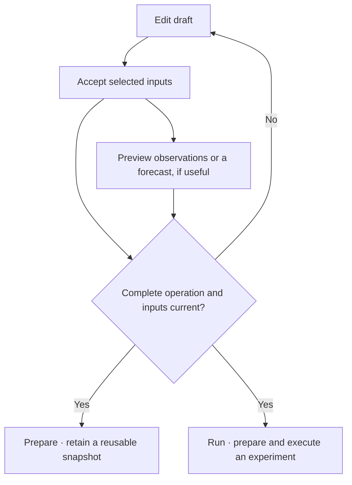

# Editable operation drafts

A draft is an incomplete recipe with ordered instruction values. It does not
embed observations, forecast grids, geometry or results. Saving a draft neither
registers instructions nor prepares inputs or starts MGB.

Library callers may initialize a draft with `Draft::new_with_workspace_config`
when the selected workspace TOML is outside its standard location.
`Draft::save_preparation_toml` saves a complete operation request atomically. It
rejects embedded instruction values that the request schema cannot represent;
save the JSON draft to retain those values without catalog registration.

## CLI actions

```sh
mgb-ops draft new --workspace /regional/workspace --output draft.json --json
mgb-ops draft import-toml --workspace /regional/workspace --request operation.toml --output draft.json --json
mgb-ops draft open --workspace /regional/workspace --draft draft.json --json
mgb-ops draft refresh --workspace /regional/workspace --draft draft.json --json
mgb-ops draft preview-observations --workspace /regional/workspace --draft draft.json --json
mgb-ops draft preview-forecast --workspace /regional/workspace --draft draft.json --scenario 0 --json
mgb-ops draft validate --workspace /regional/workspace --draft draft.json --json
mgb-ops draft prepare --workspace /regional/workspace --draft draft.json --output prepared --json
mgb-ops draft run --workspace /regional/workspace --draft draft.json --json
mgb-ops draft save --workspace /regional/workspace --draft draft.json --output copy.json --omit-visualization --json
```

`import-manifest --manifest DIRECTORY --output draft.json` copies the recipe and
actual instruction values from a retained preparation or a trial with validated
successful scenarios, including a partially failed trial. It does
not select a workspace from that artifact or make its original dependencies
available. Imported instruction values do not claim a registered origin.

`edit --draft draft.json --document replacement.json` replaces the document with
another validated draft JSON document, preserving its anchor. An incomplete
draft can supply its missing reference and timezone through this command.
`refresh --source observations` accepts the local observation selection;
`--source forecast --scenario 0` accepts one forecast selection. The default
`--source all` also checks preparation dependencies and requires a complete
operation. Scenario indices are zero-based.

Draft commands return a JSON envelope with `ok` and either `result` or `error`,
including when `--json` is omitted. Open returns the document and findings.
Validate returns action findings, defaulting to preparation. Use
`--action observations` or `--action forecast --scenario 0` for a local preview.
Nonempty findings make `ok` false. Exit codes are 0 for success,
1 for failed actions/readiness/output and 2
for invalid command arguments. Progress text is not written to JSON stdout.

Resolve CLI workspace, draft, request, manifest and output paths from the
invocation directory. Resolve relative paths inside the recipe against the
explicitly selected workspace, even when the JSON file lives elsewhere. A saved
workspace reference never replaces that selection; a mismatch produces a finding
and blocks dependent actions until the reference is repaired. External paths and
native filesystem lookup semantics remain supported.

## JSON authoring versions

The smallest incomplete document is:

```json
{
  "schema_version": 2,
  "workspace": "/regional/workspace",
  "sources": {},
  "operation": {},
  "instructions": {}
}
```

`operation` covers the settings in the [operation request](operations.md#request).
Fields and nested settings may be absent or null while editing; scenario order is
retained. New drafts initialize available engine paths from valid workspace
configuration and leave other settings incomplete. They select no forecast or
scenario automatically. Imports retain exact coverage and selections. Version 2
operations use one
`reference_time`, `time_zone`, `observed_horizon_days` and `forecast_horizon_days`;
boundary datetimes and `step_seconds` are absent. Fields may remain incomplete.
Observation-local acceptance/preview needs only the observed horizon, reference,
timezone and its own source/QC settings, independently of forecast/model readiness.
Version 1 drafts with explicit boundaries remain supported without changing
coverage or rewriting their files. Imports compact compatible version 1 periods
losslessly; incompatible periods retain version 1 and exact explicit boundaries.
Complete TOML export likewise uses version 2 only when lossless. New drafts use
version 2. The [desktop interface](desktop.md#workspace-settings-and-operation-drafts)
adds anchored filenames; explicit-path backend and
CLI save/open APIs retain their existing path behavior.
`Draft::new_run` establishes a validated fixed-reference baseline without selecting
operational sources. The CLI `draft new` accepts `--reference` and `--time-zone`
together to set the anchor on creation. Opening or saving a draft fixes any
reference and timezone already present. Library callers can use
`Draft::initialize_anchor` to fill missing anchor fields and clear prior source
acceptance. `DraftOperation::coverage` displays the shared period derivation after validating
the IANA timezone and all hourly labels against the same offset-transition rules,
and `Draft::use_day_horizons` converts legacy coverage only when every hourly label
is unchanged.

`instructions.replacements` is an optional ordered array of objects containing
`draft_id`, optional `registered_origin`, and an observation replacement `value`.
`instructions.corrections` follows scenario order, with each entry null or an
ordered array of the same wrapper around forecast correction values. Null selects
registered IDs from the operation; an array supplies actual values, including an
empty array selecting none. Draft identities remain stable while editing.
Omitted reason text is represented as an empty string. Name and reason are
optional for previews, preparation and registration; supplied text survives.
Saving does not require action readiness.

`sources` contains accepted selected-content identities and a refresh generation.
Treat identity values as opaque; use Refresh to accept available inputs. Unknown
operational fields and unsupported versions fail. Nonfinite operational numbers
are rejected rather than converted to missing values.

Optional `visualization` holds map position, selected location, visible runs and
scenarios, and chart range. Invalid optional view state may be omitted with a
finding. Save includes view state by default; `--omit-visualization` omits it.
View-only changes do not make an operation dirty.

Location identifiers are `station:<station_id>` (for example,
`station:ana:86472600`) or `mini:<positive_id>`. Map position is
`[latitude, longitude, zoom]`; chart range contains two local timestamp labels.
Visible run paths resolve against the selected workspace. Reopen reports missing
stations, minis, selected scenarios and result files without silently choosing
replacements or making the operation dirty.

## Editing, source acceptance and previews

Edit the draft, then explicitly accept the inputs for the intended action.
Preview is optional and can use a local selection. Prepare and Run require a
complete operation with current accepted inputs. If a selected source changes,
accept it again before taking an action that uses it.



[Save](#json-authoring-versions) can retain an incomplete draft.
[Registration](#explicit-registration) is a separate action for selected edits.

The public `Draft` API provides new/open/import/save/discard, typed mutable
`document` values, refresh, action validation, previews and preparation. Library
callers supply the invocation directory at the interface boundary.

Missing dependencies do not prevent saving or opening an incomplete draft.
Selected source changes block a dependent new preview or preparation until
explicit Refresh. Identities describe selected content rather than whole SQLite
files; unrelated catalog additions do not invalidate an unchanged selection.
Preparation checks identities while freezing the selected data. Existing frozen
preparations remain executable independently of the draft and original sources.

Observation previews return raw/effective rows and QC findings; forecast previews
return original/corrected native frames using shared analysis. A local preview
needs its own settings and sources, not a complete operation. Preparation uses
the current draft whether or not it has been previewed. Preview generations change
with operational edits or Refresh; callers must use `preview_is_current` before
applying a worker response. No preview registers instructions.

Saves use a temporary file beside the destination and atomic replacement. Failed
Save or Save As preserves existing destination bytes and the previous saved
baseline. Discard restores the saved document or the initial never-saved document;
it does not reverse catalog writes or remove results. Linux filesystem behavior
is qualified; Windows remains unverified.

## Explicit registration

Registration writes only the selected draft instructions. It does not register
raw observations, forecasts or model results, run preparation, or change the
working instruction values/order. Preview and preparation never register edits.

```sh
mgb-ops draft materialize --workspace /regional/workspace --draft draft.json --source observations --json
mgb-ops draft materialize --workspace /regional/workspace --draft draft.json --source forecast --scenario 0 --json
mgb-ops draft register --workspace /regional/workspace --draft draft.json --selection selection.json --json
mgb-ops draft copy-registered-for-edit --workspace /regional/workspace --draft draft.json --mapping mapping.json --json
```

Materialize copies the currently selected registered records into ordered draft
wrappers with their registered origins. It preserves unrelated draft entries and
requires explicit Refresh before the dependent preview/preparation; it does not
accept newly read source content. The public methods are
`materialize_replacements()` and `materialize_corrections(scenario)`.

`register_selected(&RegistrationSelection)` takes this selection document:

```json
{
  "replacements": ["draft-replacement-id"],
  "corrections": [{"scenario": 0, "draft_id": "draft-correction-id"}]
}
```

Both lists may be empty. The report has independent `observations` and
`forecasts` outcomes, each with `mappings` and an optional `error`. A mapping has
`draft_id`, `scenario` (null for observations), and `catalog_id`. These IDs are
opaque. Each catalog commits its selected batch atomically. An invalid item rolls
back that catalog's batch; the other catalog can succeed. The CLI returns exit 1
and `ok: false` for partial failure while retaining the successful mappings in
`result`. There is no transaction spanning both catalogs.

Retrying identical values returns the same mappings without duplicate records,
including after saving/reopening the draft. Conflicting values under an explicit
existing registration identity fail. Keep the returned mapping when beginning a
new edit of an instruction just registered from this draft: pass that single
mapping to `copy_registered_for_edit`, or save it as `mapping.json` for the CLI.
The action verifies the catalog payload before recording its origin, and must
precede changing the value. A changed registered copy receives a new catalog
identity while keeping its stable draft identity. Original catalog records and
raw data remain intact; removing a draft instruction only deselects it.

## Trial execution

`run_draft(&draft, &control)` uses the current accepted values without registering
instructions. Run prepares and executes; Prepare only retains frozen dependencies
for later execution. A successful trial recipe can be imported as a new draft,
whose selected sources must be explicitly accepted again. Trial caches contain
results and recipes rather than reusable source snapshots. Cancellation, progress,
partial failure and retention follow the [operation contract](operations.md#controlled-actions-and-cancellation).
