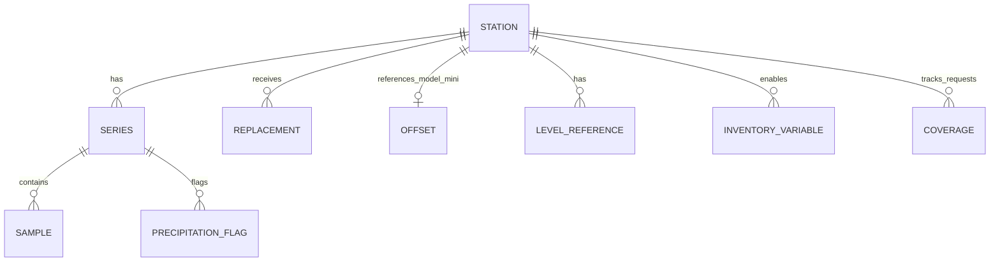

# Canonical observations and observed forcing

Workspaces store observations and station metadata under `assets/observations/`.
Standalone observation APIs accept an explicit canonical asset directory. See
[input sets](inputs.md) for run capture and retention.

## Persistence

`ObservationStore::create(path, time_zone)` creates a new asset directory and rejects an
existing destination. `open_read_only(path)` validates its tables and IANA
timezone without creating data. `write_batch` commits all
supplied rows together and rolls back invalid batches. Publication validates referential integrity and atomically selects a complete generation.

Typed Parquet tables implement the [data model](#data-model). IDs are
nonempty strings. Station coordinates are both present or both absent. Missing
station coordinates are permitted for search and data-only review; forcing
interpolation requires coordinates for selected rain stations.
Duplicate keys, orphan rows, invalid units and nonfinite values fail.
Replacement reason text may be empty or omitted; supplied text is preserved.
`open_writable` opens an existing asset directory without creating one.
Workspace edits are an ordered table. Review or change them in
**Observation review** or [import/export them as CSV](saved-data.md#canonical-data-and-review).
Saving replaces the list in an atomic publication.

## Data model



The following are logical records; application-managed generations can store
their rows across multiple files. IDs and timestamp labels are text unless
otherwise specified.

| Record | Fields |
| --- | --- |
| Station | `station_id`, `provider_code`, `station_code`, `name`, `latitude` and `longitude` (f64, both present or both absent) |
| Series | `series_id`, `station_id`, `variable`, `state`, `unit`, `interval_seconds` (optional i64), `created_at` |
| Sample | `series_id`, `observed_at`, nullable `rain` (f64), `flow` (f64), `level` (i32); the series identifies the applicable variable |
| Replacement | `replacement_id`, `station_id`, `variable`, `kind`, `start_at`, optional `end_at`, nullable `value` (f64), optional `reason` |
| Station offset | `station_id`, `mini_id` (positive i64), `offset_m` (finite f64) |
| Level reference | `station_id`, `kind`, optional `date`, `level_cm` (finite f64 retaining source precision) |
| Inventory variable | `station_id`, `variable` |
| ANA coverage | `station_id`, `variables_key`, `day`; see [request selection](acquisition.md#inventory-and-request-selection) |
| Precipitation flag | `series_id`, `observed_at`, `reason` |

| Variable | Canonical value | Interval |
| --- | --- | --- |
| Rain | Finite `RainMm(f64)`, mm | Exactly 3600 seconds |
| Level | Signed `LevelCm(i32)`, cm | Instantaneous |
| Flow | Finite `FlowM3s(f64)`, m3/s | Instantaneous |

Missing samples use `None`; a recorded missing row remains distinct from an
absent row and from a valid zero. Levels use Parquet INT32, including zero,
negative values and both i32 limits. Reads reject fractional or out-of-range
canonical levels. They never round or convert units. Finite suspicious raw rain,
including negative measurements, is retained for review.

Local timestamps use `YYYY-MM-DDTHH:MM:SS` without UTC conversion. Writes reject
fractional seconds and ambiguous/nonexistent local observation/replacement labels.
A requested interval axis must use the artifact timezone; axes crossing timezone
offset changes are not supported in this increment.

`read_selection(selection, interval, replacement_ids)` reads eligible stations,
series, samples, ordered replacement values and offsets from one pinned generation,
returning detached owned values. Rain samples use `(start,end]`; instantaneous
level/flow samples include both endpoints. Select providers and/or station IDs explicitly;
unknown selectors and unknown/duplicate replacement IDs fail. An empty replacement
list selects no edits. `read_station_offsets` returns only known records: an
absent offset stays unknown, while explicit zero and signed finite metre offsets
are valid. Each offset identifies a positive mini-basin ID.

## Selection, reviews and preparation

The pure analysis APIs accept canonical values without storage state.
`select_observation_series` picks one rainfall series per station, preferring
approved, curated, then raw, and newer creation labels within a state. Equal
winning ranks/timestamps require explicit selection. An explicit series ID
overrides ranking; gaps are never filled from a lower-ranked series.

`effective_observations` retains optional coordinates, raw presence/value, selected series, effective
value, replacement kind and applied instruction IDs. A point matches its exact
label; a period matches `[start,end)`, or every label at/after start when end is
absent. Selected instructions apply in request order, with the last match winning.
A NULL instruction removes availability; a numeric instruction can insert a
missing sample. Instructions do not rewrite raw observations. Applicable edits
for an unselected station fail; inactive edits remain recorded.

```mermaid
flowchart LR
    accTitle: Effective rainfall and observed forcing
    accDescr: Select one series per station, retain raw values, mask automatic flags, apply manual replacements in order, then interpolate through the working grid to model basins.
    series[Select series per station] --> raw[Raw observations]
    raw --> mask[Mask automatic precipitation flags]
    mask --> edits[Apply manual replacements in order]
    edits --> effective[Effective station rainfall]
    effective --> grid[Station-to-grid IDW]
    grid --> basin[Grid-to-basin IDW]
```



`detect_suspect_precipitation` reports values strictly above the supplied threshold
and consecutive hourly sequences strictly between supplied lower/upper limits.
Missing values, missing hours and nonqualifying values break a sequence. Detection
does not create review instructions. All policy values are explicit and validated.

Workspace preparation refreshes automatic precipitation exclusion flags in
the observation store using the configured thresholds. The final observation view masks
flagged values while retaining the raw measurement and flag reason. Ordered
manual replacements apply to the masked values. Prepared data freezes the
selected raw values, flags and edits together.

`prepare_observed_forcing` requires consecutive hour-aligned intervals, a regular
working grid, ordered basin geometry, IDW settings and a QC policy. Rainfall totals
cover `(start,end]`, labelled at end. It returns effective rows, QC findings,
replacement diagnostics, a working grid, basin forcing and processing provenance.
Both interpolation stages retain missingness and fail uncovered target times;
a usable station zero produces valid zero forcing. The working grid includes
cells touching the requested boundary. Basin outputs preserve geometry order.

Station-to-grid IDW chooses the nearest `min(k, available stations)` at each
endpoint using Euclidean degree distance. Coincident selected stations contribute
their mean. Other weights are `1 / distance^power`. Equal distances use station ID
order. Grid-to-basin IDW chooses static nearest grid cells, uses `1e-12` for an
exact zero distance, and renormalizes over valid selected cells. Grid ties use
flattened latitude-major/longitude-fastest index order. The two coincidence rules
are distinct. Power two uses direct squaring to reproduce qualified arithmetic.

`app::prepare_observations(&ObservedRequest)` composes explicit store selection
with this analysis and validates offset mini IDs against the supplied geometry.
It returns selected inputs, offsets and preparation values. It does not launch
MGB or finalize a reusable preparation directory. Integrated preparation and
execution are separate capabilities.

Linux behavior is tested. The [ANA acquisition contract](acquisition.md#ana-observations)
defines provider conversion and raw-series revisions. Windows and hydrological
validity remain unverified.

## Station reference levels

Import station reference levels into an initialized observation asset directory.

```sh
mgb-ops references import --assets /regional/workspace/assets/observations --provider ana --thresholds station_level_reference.csv --history registered_floods.csv --json
```

The shared action is `import_level_references(assets, provider, thresholds, history)`. Paths resolve
from the invocation directory. JSON mode returns `{ok:true,result:...}` or
`{ok:false,error:...}` on stdout, with exit 0 for success, 1 for operational
failure and 2 for invalid arguments. Import results contain the imported record
count and sorted unmatched station codes. Without
`--json`, import prints the report. It replaces all threshold/historical reference
records together, without changing stations, observation samples, replacements or
model offsets. Both files must validate before replacement. Validation or persistence
failure preserves the previous records. An initialized catalog with no imported references returns an empty collection.

Threshold CSV columns are `station_code`, `station_name`, `level_atention`,
`level_alert`, `level_flood`, `level_severe`; the spelling `atention` is intentional.
Historical CSV columns are `station_code`, `level_registered`, `date`.
Files use UTF-8 with optional BOM, comma delimiters and CSV quoting. Values are
finite source-precision f64 centimetres, including zero and negative values.
Blank thresholds omit a line; a historical level requires a value and an ISO
`YYYY-MM-DD` date. Duplicate reference keys, invalid values and dates fail,
including invalid rows for unmatched stations. Threshold keys are station/kind;
historical keys are station/level/date.

The provider is explicit and must exist in the catalog. Station codes are trimmed, uppercased and stripped of
leading zeroes consistently in the source and selected provider's catalog;
ambiguous normalized catalog codes fail. Unmatched codes are reported as skipped,
including threshold rows with no supplied levels. No stations or relationships
are created by import.

`ObservationStore::read_level_references()` returns detached `LevelReference`
values with kinds `attention`, `alert`, `flood`, `severe` or dated `historical`.
`replace_level_references` provides the same transactional storage boundary for
validated supplied records. References are optional
chart lines, independent of offsets. Station coordinates and explicit mini-link
availability follow the [spatial contract](spatial.md).
