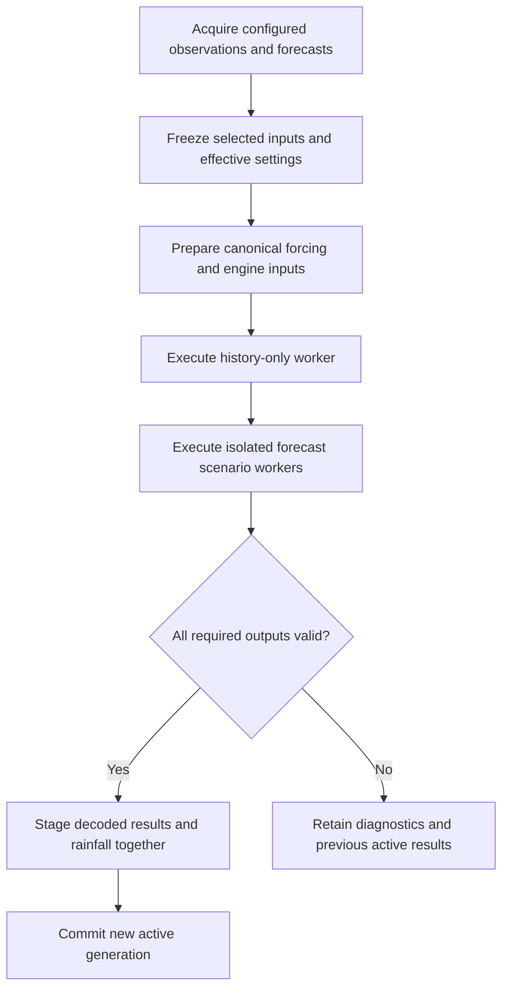
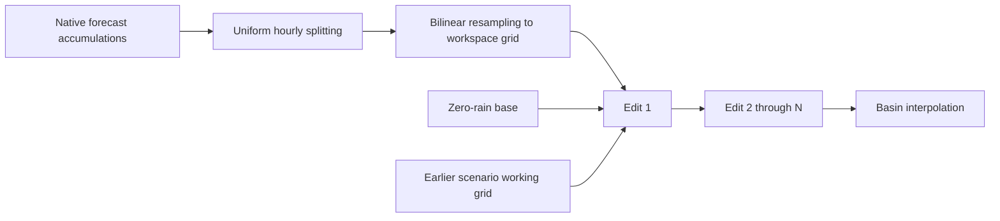

# Saved preparation and execution

## Run from a workspace

Use **Operation → New run** in the desktop or run the corresponding CLI commands.

```sh
mgb-ops operation run-all --workspace /region --json
mgb-ops operation prepare --workspace /region --output /region/runs/prepared --json
mgb-ops operation execute --workspace /region --prepared /region/runs/prepared --json
```

**Run All** acquires configured inputs, freezes the run inputs, executes MGB, and
publishes the completed generation. Desktop **Capture inputs** stops before materialization and execution.
The CLI `operation prepare` materializes saved inputs and stops before execution. A saved preparation retains everything needed to execute
after its original sources change. Relative command paths resolve from the
invocation directory. Paths in workspace settings resolve from the workspace.



The [input contract](inputs.md) defines registration, export and retention. The [architecture](../architecture.md#operational-data-flow)
maps these stages to their owners. Execution and publication failure handling
is specified [below](#execution-lifecycle).

Override the hour with `--reference-time` and the windows with
`--lookback-days` and `--forecast-days`. Local labels use the workspace time
zone and whole hours. History starts at midnight on the reference date minus
the lookback days and ends at the reference hour. Forecast labels start one hour
after the reference and end at the reference plus the forecast days plus one
hour. Rainfall labels mark interval ends. Ambiguous or nonexistent local labels
and time windows crossing a timezone offset change fail validation.

## Scenarios

Workspace TOML may supply an ordered scenario list. With no explicit list in
the session or configuration, the run selects zero future rain followed by the
latest usable cycle for each provider, model and product. Eligible cycles start
at or before the reference and cover the forecast window. The catalog may contain
cycles from disabled acquisition providers. Automatic forecast IDs use the
provider, model and product. Run All resolves this selection after acquisition.

Repeat `--scenario` to supply an ordered list. Each entry has a unique ID of
one to 64 ASCII letters, digits, underscores or hyphens, beginning with a
letter or digit. Its base is zero, a forecast selector, or an earlier scenario's
ID. A selector names a provider or a specific `provider/model/product` and can
pin a cycle with `@UTC-cycle`. The CLI also accepts `zero` and a plain forecast
selector as shorthand.

```sh
mgb-ops operation run-all --workspace /region \
  --reference-time 2026-07-20T00:00:00 \
  --scenario zero \
  --scenario '{"id":"ifs","base":{"kind":"forecast","forecast":"ecmwf/ifs/fc@2026-07-20T00:00:00Z"}}' \
  --scenario '{"id":"wet","base":{"kind":"scenario","id":"ifs"},"edits":[{"start":"2026-07-20T06:00:00","end":"2026-07-20T18:00:00","multiplication_factor":1.1,"rotation_deg":0,"shift_lat_pixels":0,"shift_lon_pixels":0}]}'
```



The edit sequence can be empty. Each edit reads the previous edit's grid;
preview and execution use the same transformations. Processing order is part
of the numerical contract: editing native accumulations before resampling is
not equivalent to editing the hourly workspace grid.

| Parameter or rule | Behavior |
| --- | --- |
| `id` | Unique user scenario ID; later scenarios may name it as their base |
| `base` | Zero rainfall, a selected forecast, or an earlier scenario; forward references and cycles fail |
| `start`, `end` | Hour-aligned local boundaries selecting hourly intervals within `[start,end)` |
| `bbox` | Optional `[west,south,east,north]`; only output cells with centres inside the box change |
| `multiplication_factor` | Finite nonnegative factor applied to sampled rainfall; defaults to one |
| `shift_lon_pixels`, `shift_lat_pixels` | Translation in workspace-grid pixels, positive east and north; defaults to zero |
| `rotation_deg` | Counterclockwise rotation after translation, around the box centre or full working-grid centre; defaults to zero |
| Spatial sampling | Nearest source cell; missingness is preserved and an out-of-grid source produces missing output |
| Grid footprint | Fixed across edits; transforms do not expand it |

All scenarios share the effective [observation
history](observations.md#selection-reviews-and-preparation).

Library callers can edit typed `RunParameters` and `RunScenario` values in the
workspace session. The frozen recipe records the resolved base and edit order.

## Active run and rainfall cache

`results/active.toml` selects the successful result generation supplying model
results, rainfall and processed masks. Publication switches the validated
results and rainfall together. Failed or cancelled attempts retain diagnostics
and leave the previous result active. Workspace executions share a lock.

Each attempt has a dated TOML manifest in `runs/`, including resolved inputs,
settings and outcome. Ordinary superseded results may be reclaimed. Use
`mgb-ops run keep --workspace /region --id RUN_ID` while results are available
to retain them across replacement; `run release` permits later reclamation and
`run retained` lists kept results. Independently export a run to retain it outside
the workspace. Manifests and their registered inputs remain available separately.

## Execution lifecycle

Under the workspace lock, execution verifies a private preparation and runs a
history-only worker. A run that prepares its own inputs uses that preparation
directly. Execution of a saved preparation takes a verified private copy.
After history completes, each isolated forecast worker stages its own inputs
and starts MGB as soon as those inputs are ready. Execution joins the workers,
validates all requested scenarios, stages rainfall from the same prepared
inputs, and removes temporary inputs. It syncs the generation before committing
the results and rainfall together.

A cancellation before the commit stops and reaps owned engines. Failed
execution, rainfall preparation, or publication leaves the previous active
generation available. See [control and cancellation](#controlled-actions-and-cancellation).

## Prepared dependencies and run files

Preparation freezes selected canonical observation rows, ordered observation replacements and
scenario edits, station metadata and offsets, selected normalized forecast
grids, numerical settings, and baseline Input. A prepared execution directory
also carries a copy of the selected executable and generated forcing. An [independent export](inputs.md) retains the executable
identity and recipes alongside selected input values. Canonical forcing and
checkpoints retain f64 precision.
The generated `manifest.toml` records resolved settings, scenario recipes and
outcomes, and the files needed to validate the snapshot.

The prepared tree contains `sources/`, `baseline/Input/`, `baseline/engine`,
`forcing/` and `checkpoints/`. Each selected scenario has a combined
historical/forecast `forcing/<id>.nc`. The baseline remains separate from
writable engine inputs. Preparation stages a new destination and removes its
staging files on failure or cancellation.

```text
<prepared>/
├── manifest.toml               Resolved recipe, input integrity and scenario records
├── sources/                    Frozen canonical dependencies and recipe
├── baseline/
│   ├── Input/                  Retained baseline; separate from writable worker inputs
│   └── engine                  Selected executable (engine.exe on Windows)
├── forcing/
│   └── <scenario>.nc           Combined historical and forecast basin forcing
└── checkpoints/                Retained rainfall preparation checkpoints
```

A portable input export excludes generated forcing and executable bytes.

Execution takes a nonblocking OS lock on `<workspace>/.operation.lock`, held until
children and workers stop and file work finishes. Concurrent execution in that
workspace returns `Busy`. Each invocation stages a generation privately under
`work/`. Finalization removes the verified preparation snapshot,
shared history inputs, and isolated worker inputs.

The active generation supplies validated `results/<id>/basin.nc` and
`station.nc`, the four original streams in `scenarios/<id>/Output/`, and
diagnostics. Small `results/<id>/engine-inputs/` files record the actual generated
metadata and rainfall digest. Supported engines provide an optional flood source
for each successful scenario. See [inundation processing](inundation.md).

`discover_trials(workspace)` returns the active root when present.
`read_trial(root)` validates canonical results and required engine streams
at an active or explicitly saved root. A bundle containing the matching input set supports regeneration using a matching
installed executable after the original sources are removed.

Scenarios run concurrently in isolated directories with direct executable
invocation, an explicit working directory, and only `MGB_INPUT_DIR`,
`MGB_OUTPUT_DIR` and `OMP_NUM_THREADS` in the environment. Stdout and stderr go
directly to separate files. Execution records include command, environment,
status and elapsed time. Every launched child is waited for and every worker is
joined. Failure returns a structured operation error. `BatchFailed` carries
per-scenario status. Historical diagnostics are available in the attempt manifest.

## Controlled actions and cancellation

Use a fresh `OperationControl` for each preparation, Run All, or controlled
execution. Run All holds the workspace lock from acquisition through publication
and removes its temporary preparation on completion.

Cloned controls expose `cancel()`, `is_cancelled()` and the latest `progress()`.
Progress identifies acquisition, preparation, history, scenarios and finalization, includes the
attempt path when known and per-scenario state, and leaves unknown fractions
absent. `OperationControl::with_observer` also delivers milestones, download
updates and engine log chunks to a callback that can be called from concurrent workers.
`tail_log(path, max_bytes)` reads at most 65,536 trailing bytes without loading the
entire file.

`operation prepare`, `operation execute`, `operation run-all` and
`run regenerate` print live run milestones. The CLI displays
engine output as the executable flushes it. Each line identifies the shared
history or scenario and the engine's stdout or stderr.
Text commands use stdout. Commands returning JSON use stderr for live output,
including `run regenerate` without `--json`. JSON reports
are single documents on stdout. If the console falls behind, its output names
the affected stream and the number of skipped bytes. Engine log files retain
their original bytes under the usual run retention rules.
See the [acquisition contract](acquisition.md) for the download display.

CLI SIGINT requests cancellation. Controlled cancellation checks preparation
boundaries, stops and reaps owned engines, joins concurrent workers, and finishes
cleanup under the lock. Cancellation before the final commit records the
cancellation reason in the attempt manifest and keeps the previous active run.
Cancellation after the commit preserves success. After hard process termination,
the next writable execution cleans up abandoned working stages. Engine-created
descendant processes are outside the normal cancellation guarantee.

## Engine and canonical results

CHUVABIN is little-endian f32, time outermost and basin innermost, without headers
or record markers. MINI.gtp supplies actual mini IDs, order and centroids.
Metadata edits preserve unrelated baseline content and calibration. Every private
Input carries the retained baseline state. An explicit qualified state request
retains state under the successful scenario.

The qualified decoder keeps four original streams separate. A history-only run
recovers levels overwritten by the engine's forecast prefix; historical flow and
the unaffected level suffix must agree across scenarios. Labels follow the
supplied application axis, with rainfall bounds retained independently. Exact
stream lengths and finite values are validated.

Basin NetCDF stores precipitation in f64 mm, flow in f64 `m3 s-1`, raw level in
signed i32 cm and separate u8 validity masks. `time_segment` is 0 for history and
1 for forecast. Coordinates, ordered mini IDs, local times/bounds, timezone,
reference time, engine identity, snapshot identity and processing provenance are
explicit. There is no numeric packing.

Station results preserve requested station order and full-precision metre offsets.
Raw level is `round_ties_even(100 * engine_metres)`; station level is
`round_ties_even(100 * (engine_metres - offset_metres))`. The offset is applied
before rounding, independently of raw centimetres. Valid negative/zero levels and
the full i32 range are supported; overflow fails. Missing integer payloads are
exactly zero with mask zero. Unknown offsets retain station identity but have
unknown mini/offset/levels; explicit zero and signed offsets are valid. Multiple
stations can reference the same mini with different offsets. No AR(1) is applied.

JSON reports contain resolved artifact paths and scenario outcomes. CLI success
exits 0, operational failure exits 1 and argument errors exit 2. Library errors
identify invalid requests/preparations, busy workspaces, source/storage failures
or model failures without embedding binary or full observation contents.

Linux is the qualification platform. Windows, live providers, warm-state
consumption and hydrological validity remain unqualified. Scientific evidence
and the saved case's state caveat live with the
[regression reference](../../references/regression/rs-hourly/README.md).
