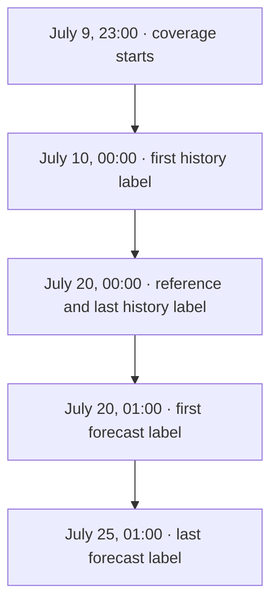
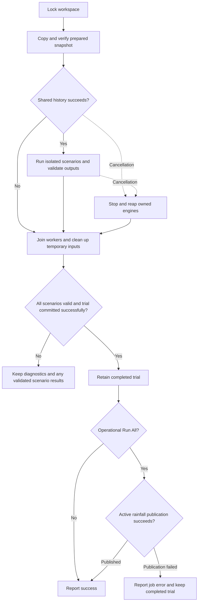

# Saved preparation and execution

## Choose an execution path

| Action | Start with | Retains after success | Publishes active rainfall |
| --- | --- | --- | --- |
| `operation prepare` | Complete operation TOML | Reusable preparation. Stops before engine execution. | No |
| `operation execute` | Retained preparation | Isolated trial | No |
| `draft run` or **Run experiment** | Draft with accepted inputs | Isolated trial. Removes the temporary preparation. | No |
| **Processing → New run → Run All** | Operation TOML with inputs accepted for the chosen local reference | Isolated trial. Removes the temporary preparation. | Yes |

Use [operation drafts](drafts.md) to edit and preview a recipe, or the
[desktop run form](desktop.md#controlled-jobs) to run a saved recipe for a selected
reference. The shared library exposes `prepare(PreparationRequest)` and
`execute_prepared(ExecutionRequest)`, also available through the CLI.

```sh
mgb-ops operation prepare --workspace /regional/workspace --request request.toml --output prepared --json
mgb-ops operation execute --workspace /regional/workspace --prepared prepared --json
```

Workspace, request, output and prepared arguments resolve from the invocation
directory. Paths inside the request resolve from the selected workspace.
Preparation creates a new directory and never invokes MGB. Execution uses retained
prepared dependencies, independently of subsequent changes to their source files.
A new preparation is needed to select different data or settings.

Library callers can also use `prepare_typed(TypedPreparationRequest)` with a
`PreparationDocument` and the same workspace, invocation-directory and output
path rules. `replacements: None` resolves the document's replacement IDs;
`Some(values)` supplies the ordered replacement values and replaces those IDs.
`corrections` contains one entry per scenario in scenario order: `None` resolves
its correction IDs, while `Some(values)` supplies ordered correction values and
replaces those IDs. Use `None` for a zero scenario. Supplied records receive the
same validation as registered records and are not registered in source catalogs.
The prepared snapshot retains their actual values and a generated request, so it
can execute after the original sources are removed.

[Editable drafts](drafts.md) provide incomplete JSON recipes, explicit source
acceptance and unregistered previews over this same typed preparation workflow.

The desktop's [standalone run form](desktop.md#controlled-jobs) uses
`app::OperationalRun` to load an explicitly selected TOML recipe, substitute
the selected local reference and require acceptance before preparing or running.
Version 2 recalculates the day horizons. Version 1 shifts the explicit boundary
labels by the same number of local hours as the reference. Other selections,
including asset and correction IDs and any explicit state-capture timestamp,
retain their saved values and are validated against the chosen reference.

## Active rainfall cache

One generation per workspace supplies rainfall views. Its reference, timezone,
coverage and scenario list describe the latest successful operational Run All.
The pipeline stages its inputs temporarily and removes them after execution.
Experiment runs and explicit execution of existing preparations leave the active
display cache alone.

The active generation is selected atomically by `data/cache/rainfall/active.json`.
It retains the observed and selected scenario working grids, prepared basin
forcing, and frozen MINI.gtp. Zero scenarios use the working grid geometry and
verified zero forecast intervals. Successful replacement retires the previous
generation. A failed or cancelled update before the switch preserves the active
generation. A cache publication error after successful model execution leaves
the completed trial and surfaces a job error.

`app::rainfall_cache_info` reads the active metadata, and
`app::query_cached_rainfall` returns an overlay and optional basin summary from
the same generation. Missing caches return no rainfall. Selected artifacts are
checked on read and missing or corrupt inputs surface as findings. Read-only
queries create no artifacts. Trial and preparation discovery do not participate
in rainfall display.

## Request

The separate UTF-8 TOML request is strict at every table: unknown keys fail.
Inspection's `config/workspace.toml` remains separate. This small example selects
saved observations and a zero-rain forecast; replace paths and times for the
selected regional baseline:

```toml
schema_version = 2
time_zone = "America/Sao_Paulo"
reference_time = "2026-07-20T00:00:00"
observed_horizon_days = 10
forecast_horizon_days = 5

[observed]
path = "data/observations.sqlite"
provider_codes = ["ana"]
station_ids = []
series_ids = []
replacement_ids = []

[geometry]
mini_gtp = "mgb_runner/Input/MINI.gtp"

[grid]
bbox = [-58.95016, -34.40217, -48.85759, -26.29721]
resolution_degrees = 0.1

[interpolation]
nearest_stations = 5
power = 2.0

[qc]
high_threshold_mm = 50.0
sequence_lower_mm = 0.0
sequence_upper_mm = 1.0
sequence_min_length = 5

[levels]
station_ids = []

[engine]
executable = "mgb_runner/MGB_Inercial_Prev_RSH"
input_dir = "mgb_runner/Input"
omp_threads = 1

[forecasts]
catalog = "data/forecasts.sqlite"

[[scenarios]]
id = "zero"
kind = "zero"
```

All shown scalar settings and tables are required. `series_ids` may be omitted;
replacement IDs must be explicit, including `[]` to select no reviews. At least
one provider or station selector is required. See the
[observation contract](observations.md) for ranking and ordered replacements.
QC findings do not automatically create reviews. Output level station IDs are
explicit and ordered; `[]` requests no station columns. Unknown stations fail.

Times are local `YYYY-MM-DDTHH:MM:SS`, hour aligned, in the supplied IANA timezone.
Version 2 authoring has one datetime: `reference_time`. `observed_horizon_days`
is a nonnegative integer; `forecast_horizon_days` is a positive integer. Hourly
steps are fixed. The first historical label is midnight on the reference date
minus observed days; the last is the reference. Forecast labels run from reference
plus one hour through reference plus forecast days plus one hour, inclusively.
Thus the example has 241 historical and 121 forecast labels; a non-midnight
reference adds historical labels since midnight. These are interval-end labels,
so covered rainfall begins one hour before the first label.
Historical and forecast axes are contiguous. In the example, the first history
interval starts at July 9, 23:00 and ends at the first history label, July 10,
00:00. July 20, 00:00 is both the final historical label and the reference.
The forecast labels run from July 20, 01:00 through July 25, 01:00.



Explicit boundary datetimes and `step_seconds` cannot be combined with version 2
day horizons.

Version 1 requests with `step_seconds = 3600` and explicit
`historical_first_end`, `historical_last_end`, `forecast_first_end`, and
`forecast_last_end` remain readable with their original exact coverage. The
reference must equal the final historical endpoint, followed by the first
forecast endpoint one hour later. The typed `PreparationDocument` API and retained
recipes keep this resolved version 1 representation; retained preparations,
requests and manifests are not rewritten. Draft import/export converts to version
2 only when expansion reproduces every original boundary and step exactly;
otherwise it retains version 1. No rounding to whole days occurs.
Ambiguous/nonexistent local labels and offset transitions
fail. Grid bounds and resolution, IDW settings, QC thresholds and thread count
are validated. Engine-bound rainfall must be present, finite and nonnegative.

Scenario IDs are unique and match `[A-Za-z0-9][A-Za-z0-9_-]{0,63}`. At least one
scenario is required. `kind` selects:

| Kind | Asset | Corrections |
| --- | --- | --- |
| `zero` | Omitted | Omitted |
| `raw` | Required `asset_id` | Omitted or `correction_ids = []` |
| `corrected` | Required `asset_id` | Required nonempty ordered `correction_ids` |

IDs resolve through the explicitly selected forecast catalog. Duplicate/unknown
instructions and cross-asset corrections fail. Zero scenarios need no forecast
asset or catalog file. See the [forecast contract](forecasts.md) for normalization
and correction semantics. Baseline Input must contain compatible geometry,
metadata, calibration and initial-state dependencies. See the [additional inputs
and state contract](saved-data.md#forcing-state-and-calibration) for optional
forcing, calibration selection and state capture.

## Execution lifecycle

Under the workspace lock, execution verifies a snapshot of the preparation and
runs a history-only worker before launching isolated scenario workers. It then
joins workers, cleans up temporary inputs, and commits the trial outcome. Failed
or cancelled trials keep diagnostics and any validated results. When there are
no successful scenarios, execution retains logs without a result manifest.



A cancellation before the final commit stops and reaps owned engines and
prevents a successful outcome. If active rainfall publication fails after the
trial completes, the completed trial remains available and the job reports an
error. See [controlled actions and cancellation](#controlled-actions-and-cancellation)
and [active rainfall cache](#active-rainfall-cache).

## Prepared dependencies and run files

Preparation freezes selected canonical observation rows, ordered replacement and
correction values, station metadata/offsets, selected forecast source/native files,
request bytes (or a generated typed request), numerical settings, baseline Input
and executable. Source SQLite subsets are read consistently rather than copied
from an open WAL file. Canonical
forcing/checkpoints retain f64 precision. A version-1 `manifest.json` records the
recipe and input paths, kinds, sizes and SHA256 identities.

Manifest fields are `schema_version`, `state`, `recipe`, `inputs`, `scenarios`,
`created_at`, `finished_at`, `error` and optional `preparation_sha256`. The latter
identifies the preparation used by a new trial; older manifests omit it. State is `prepared`, `running`, `failed`
or `completed`. The recipe contains the resolved request document, full selected
station/series and instruction records, historical/forecast counts, selected
output stations, offsets and thread count. Each input reference has `path`,
`kind`, `size` and `sha256`; paths are relative to the artifact directory.
Scenario records preserve request order and contain `id`, `state`, timestamps,
`exit_code`, `signal`, structured `error`, `stdout`, `stderr`, `basin_result`
and `station_result`. Pending outcome fields are null. Errors contain `stage`,
`message` and `log_paths`. Manifest timestamps use operation-local labels;
execution logs additionally record monotonic `elapsed_seconds`.

The prepared tree contains `request.toml`, `sources/`, `baseline/Input/`,
`baseline/engine`, `forcing/` and `checkpoints/`. Each selected scenario has a
combined historical/forecast `forcing/<id>.nc`. The original baseline and source
files remain separate from writable engine inputs. Symlinks and escaping retained
paths fail. Files are closed and synced before atomic finalization to a new
destination on Linux. Failed or cancelled staging is removed; an existing complete
preparation is preserved.

Execution takes a nonblocking OS lock on `<workspace>/.operation.lock`, held until
children and workers stop and all file work finishes. Concurrent execution in that
workspace returns `Busy`; the lock file's existence alone means nothing. Each
invocation reserves a fresh disposable trial under `data/runs/`. During execution
it uses a verified preparation snapshot, shared history worker and isolated
scenario inputs. Finalization removes those temporary working trees.

A trial with successful scenarios retains its recipe, preparation identity,
validated canonical `results/<id>/basin.nc` and `station.nc`, the four original
engine streams under `scenarios/<id>/Output/`, and debugging logs. Small
`results/<id>/engine-inputs/` evidence retains the actual generated metadata and
rainfall digest. These are comparison caches, not reusable preparations or a run
registry. The root manifest has no retained input references after cleanup.
Failed scenarios lose incomplete outputs. Zero successes leaves debugging logs
without a result manifest. No Save run action, retention policy or automatic cache
cleanup is provided. Existing saved artifacts are neither rewritten nor removed.

`discover_trials(workspace)` lists retained manifest roots; `read_trial(root)`
validates successful canonical results and required engine streams. Older saved
runs remain readable. Copying a recipe does not recover missing source bytes.
Use an independently saved preparation for source-independent re-execution.

Scenarios run concurrently in isolated directories with direct executable
invocation, an explicit working directory, and only `MGB_INPUT_DIR`,
`MGB_OUTPUT_DIR` and `OMP_NUM_THREADS` in the environment. Stdout and stderr go
directly to separate files. Execution records include command, environment,
status and elapsed time. Every launched child is waited for and every worker is
joined. Failed scenarios preserve validated successful siblings and diagnostics.
Success requires all selected scenarios and required outputs to validate, cleanup
to finish and the outcome to persist. Failure returns a structured operation
error; `BatchFailed` carries the partial `ExecutionReport`. Persistence and cleanup
errors identify their paths and never claim success.

## Controlled actions and cancellation

Use a fresh `OperationControl` per action with `prepare_controlled`,
`Draft::prepare_controlled`, `execute_prepared_controlled` or `run_draft`. The
ordinary preparation/execution functions use the same workflow with a fresh
control. `run_draft` prepares current accepted draft values and executes while
holding the workspace lock throughout. It removes its own temporary preparation;
Prepare only saves a reusable preparation and stops before launching MGB.

Cloned controls expose `cancel()`, `is_cancelled()` and the latest `progress()`.
Progress identifies preparation, history, scenarios and finalization, includes the
attempt path when known and per-scenario state, and leaves unknown fractions
absent. `tail_log(path, max_bytes)` reads at most 65,536 trailing bytes without
loading the entire file. JSON stdout contains the result, not progress text.

CLI SIGINT requests cancellation. Controlled cancellation checks preparation
boundaries, stops and reaps owned engines, joins concurrent workers, and finishes
cleanup under the lock. It returns an error while preserving validated successful
scenario caches and logs. Cancellation before the final commit marks the batch
failed with an explicit cancellation reason; cancellation after that commit
preserves success. Existing reusable preparations and unrelated attempts survive.
Hard process termination and engine-created descendant processes are outside this
normal cancellation guarantee; automatic recovery is not provided.

## Engine and canonical results

CHUVABIN is little-endian f32, time outermost and basin innermost, without headers
or record markers. MINI.gtp supplies actual mini IDs, order and centroids.
Metadata edits preserve unrelated baseline content and calibration. Every private
Input carries the retained baseline state. An explicit qualified state request
retains state under the successful scenario.

The qualified decoder keeps four original streams separate. A history-only run
recovers levels overwritten by the engine's forecast prefix; historical flow and
the unaffected level suffix must agree across scenarios. Labels follow the
supplied application axis, with rainfall bounds retained independently. Exact
stream lengths and finite values are validated.

Basin NetCDF stores precipitation in f64 mm, flow in f64 `m3 s-1`, raw level in
signed i32 cm and separate u8 validity masks. `time_segment` is 0 for history and
1 for forecast. Coordinates, ordered mini IDs, local times/bounds, timezone,
reference time, engine identity, snapshot identity and processing provenance are
explicit. There is no numeric packing.

Station results preserve requested station order and full-precision metre offsets.
Raw level is `round_ties_even(100 * engine_metres)`; station level is
`round_ties_even(100 * (engine_metres - offset_metres))`. The offset is applied
before rounding, independently of raw centimetres. Valid negative/zero levels and
the full i32 range are supported; overflow fails. Missing integer payloads are
exactly zero with mask zero. Unknown offsets retain station identity but have
unknown mini/offset/levels; explicit zero and signed offsets are valid. Multiple
stations can reference the same mini with different offsets. No AR(1) is applied.

JSON reports contain resolved artifact paths and scenario outcomes. CLI success
exits 0, operational failure exits 1 and argument errors exit 2. Library errors
identify invalid requests/preparations, busy workspaces, source/storage failures
or model failures without embedding binary or full observation contents.

Linux is the qualification platform. Windows, live providers, warm-state
consumption and hydrological validity remain unqualified. Scientific evidence
and the saved case's state caveat live with the
[regression reference](../../references/regression/rs-hourly/README.md).
